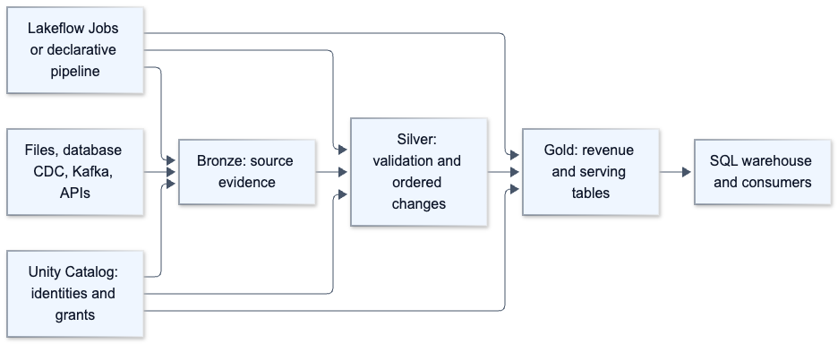
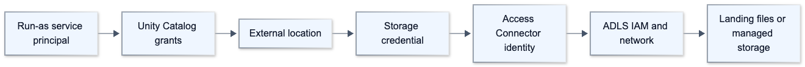
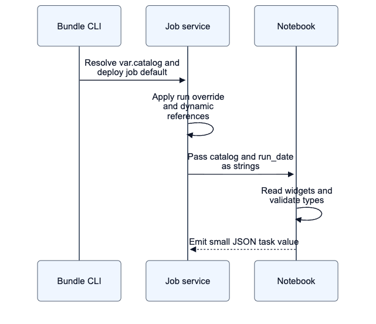
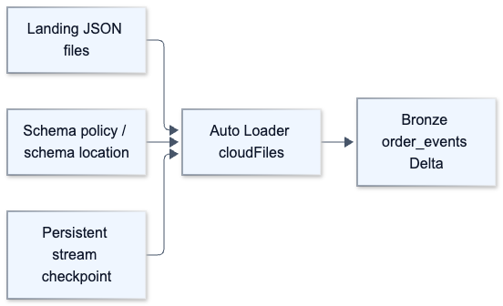
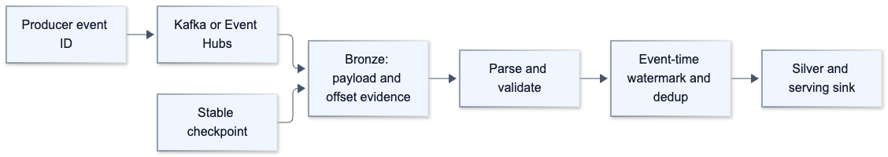
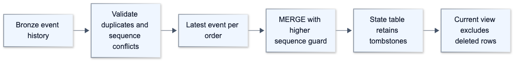
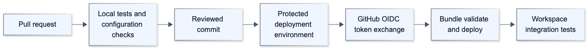
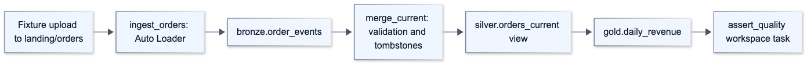
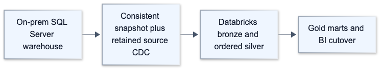
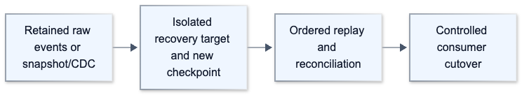

# Diagram gallery

Every chapter/scenario includes editable Mermaid diagrams that GitHub can render. All 58 diagrams are extracted into [the manifest](diagram_manifest.json) and checked by the renderer. These ten samples are also exported as PNG/SVG for readers without Mermaid rendering.

## 01-platform-and-lab-1

[SVG](rendered/01-platform-and-lab-1.svg)

## 03-azure-storage-identity-1

[SVG](rendered/03-azure-storage-identity-1.svg)

## 05-parameter-cheatsheet-1

[SVG](rendered/05-parameter-cheatsheet-1.svg)

## 09-auto-loader-1

[SVG](rendered/09-auto-loader-1.svg)

## 13-kafka-event-hubs-1

[SVG](rendered/13-kafka-event-hubs-1.svg)

## 15-cdc-scd-merge-1

[SVG](rendered/15-cdc-scd-merge-1.svg)

## 21-github-actions-1

[SVG](rendered/21-github-actions-1.svg)

## 28-worked-orders-lab-1

[SVG](rendered/28-worked-orders-lab-1.svg)

## 01-on-prem-migration-1

[SVG](rendered/01-on-prem-migration-1.svg)

## 10-replay-disaster-recovery-1

[SVG](rendered/10-replay-disaster-recovery-1.svg)
