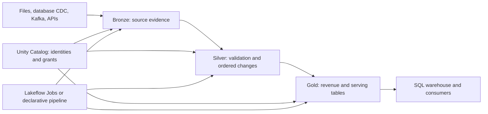

# 01. Platform map and the shared lab

Know what runs where, and use one consistent set of names throughout the guide.

## Data design

The lab models order change events, including retries, out-of-order updates, and deletes. The functional result is a current-order table and daily revenue. Freshness, recoverability, privacy, and cost are separate acceptance criteria. A job succeeding does not establish that its revenue is correct.

| Object | Lab value | Purpose |
|---|---|---|
| Catalog | `de_lab_dev` | Development isolation; production uses `de_lab_prod` |
| Schemas | `bronze`, `silver`, `gold`, `ops` | Raw events, current state, aggregates, files/state |
| Landing volume | `de_lab_dev.ops.landing` | Files uploaded by you or an upstream system |
| State volume | `de_lab_dev.ops.state` | Stream checkpoints and schema metadata |
| Order source folder | `/Volumes/de_lab_dev/ops/landing/orders` | JSON lines; immutable file names |
| Ingestion checkpoint | `/Volumes/de_lab_dev/ops/state/orders_bronze_v1` | One logical stream only |
| Auto Loader schema | `/Volumes/de_lab_dev/ops/state/orders_schema_v1` | Separate from stream checkpoint |
| Job | `orders_daily` | Ingest → validate/merge → publish → assert |
| Catalog parameter | `catalog` | String supplied by target, overridden per job run |

All cloud resource IDs, hosts, users, groups, client IDs, compute IDs, and storage account names must be replaced. `de.example` and `example.invalid` are illustrative. Numeric capacities are starting points for a small lab, not sizing promises. No workspace was connected while authoring this guide.

## Buttons and first action

Open your Azure Databricks workspace from the Azure portal using **Launch Workspace**. In the workspace, locate **Catalog**, **Workspace**, **Compute**, **Jobs & Pipelines**, and **SQL Warehouses**. Administrative actions in the account console and Azure IAM are separate from workspace permissions. Complete chapters 02–04 before running the orders lab in chapter 28.

## Governance and infrastructure automation

Use an account group `de_lab_engineers`, a consumer group `de_lab_readers`, and a service principal for production execution. Assign each to the intended workspace. Storage cloud IAM authorizes the Databricks storage identity; Unity Catalog grants authorize the person or workload. Both must pass, along with network reachability.

## Code push and maintenance

The examples are below `examples/`. Jobs examples are deployed through Declarative Automation Bundles. Lakeflow pipeline code is an alternative implementation; do not point both implementations at the same target tables. Names formerly used in tutorials include Databricks Asset Bundles, Delta Live Tables, Workflows, and Repos. This guide uses current product labels and links to the current official references.

## Tests and completion evidence

Record four results separately: local unit tests, local configuration validation, workspace integration tests, and user acceptance reconciliation. Only the first two are possible without a workspace. Save the workspace run URL, source version, parameter values, output table versions, and reconciliation result when completing a lab.

## Official references

- [Jobs](https://docs.databricks.com/aws/en/jobs)
- [Python Ref](https://docs.databricks.com/aws/en/ldp/developer/python-ref)
- [Ci Cd](https://docs.databricks.com/aws/en/dev-tools/bundles/ci-cd)

[Guide index](../../DATABRICKS_GUIDE_INDEX.md)
