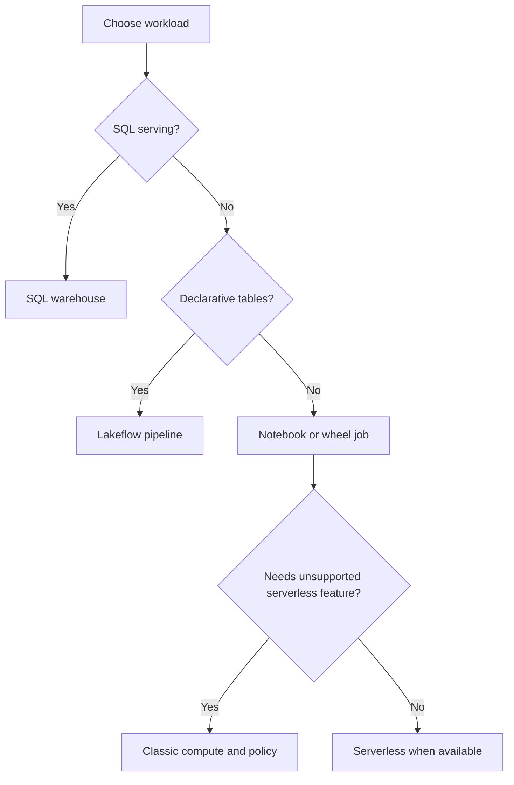

# 02. Workspace prerequisites and compute choices

Choose a runtime, identity, and execution surface before copying connector code.

## Data design

| Surface | Use it for | What you control |
|---|---|---|
| Notebook on serverless | Interactive SQL/Python and supported jobs | Environment dependencies; not worker VM type |
| Classic job compute | Workload needing a chosen runtime/network configuration | Runtime, access mode, policy, workers |
| SQL warehouse | BI queries and SQL tasks | Warehouse size/type and scaling |
| Lakeflow pipeline | Declarative streaming tables/materialized views | Source assets, catalog/schema, pipeline settings |

For the reference classic-compute alternative, select **Compute → Create compute**, enter Name `de-lab-interactive`, choose an allowed policy and a current supported LTS runtime, open **Advanced** and use **Standard** access mode for ordinary ETL. Select an allowed worker type in your region, enable autoscaling with Min workers `1`, Max workers `2`, and set inactivity termination to `20` minutes for the lab if allowed by policy. Click **Create**. Do not assume Azure VM identifiers work on AWS or GCP.

Use the notebook's compute selector to attach the notebook. For SQL use **SQL Warehouses → Create SQL warehouse**, Name `de-lab-sql`, serverless when available, a small allowed size, and an auto-stop interval supported by the selected warehouse type. Click **Create**. A policy may hide or lock fields; use its allowed value instead of fighting the policy.

## Governance and infrastructure automation

Creating compute, attaching to compute, creating tables, and reading source storage are different grants. Verify the job's **Run as** identity, not just the notebook author. Standard and Dedicated have different isolation and API limitations. Fine-grained policies on Dedicated require compatible runtime and serverless support. Serverless networking is configured independently of a classic cluster's VNet/VPC.

For a classic job definition, supply `spark_version`, `node_type_id`, `data_security_mode`, `policy_id` when required, and `autoscale.min_workers/max_workers`. Obtain actual values from your workspace's runtime/node-type selectors or CLI list commands. Do not paste an arbitrary runtime identifier into production.

## Code push automation and maintenance

Keep compute configuration in target-specific bundle variables. Store no personal existing-cluster ID as the universal production default. Pin Python dependencies and test the runtime upgrade in an isolated catalog. Serverless examples omit a job-cluster definition; that does not guarantee your workspace has serverless enabled.

## Tests

Run `SELECT current_user(), current_catalog(), current_schema()` and a one-row write in the disposable lab schema. Verify the execution principal can read the landing volume and write the state volume. Run the same test as the production service principal. Record start-up latency separately from processing latency when sizing an SLA.

## Official references

- [Configure](https://docs.databricks.com/aws/en/compute/configure)
- [Standard Overview](https://docs.databricks.com/aws/en/compute/standard-overview)
- [Single User Fgac](https://docs.databricks.com/aws/en/compute/single-user-fgac)
- [Create Sql Warehouse](https://docs.databricks.com/aws/en/sql/admin/create-sql-warehouse)

[Guide index](../../DATABRICKS_GUIDE_INDEX.md)
