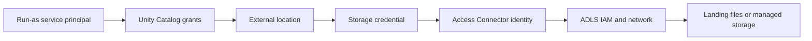

# 03. Azure storage identity and external locations

Connect ADLS Gen2 with an Access Connector, then expose storage through Unity Catalog.

## Data design and buttons

Use an ADLS Gen2 account with hierarchical namespace enabled. Keep externally uploaded landing files separate from catalog-managed table storage.

| Azure field | Example to replace |
|---|---|
| Subscription | Your development subscription |
| Resource group | `rg-de-lab` |
| Connector name | `ac-de-lab` |
| Region | Same approved region as storage/workspace |
| ADLS container | `de-lab` |
| Landing prefix | `landing/` |
| Managed-table prefix | `managed/` |

In Azure Portal: **Create a resource → Access Connector for Azure Databricks → Create**. Fill **Basics** with the values above, complete creation, and copy the connector's resource ID from its Overview. In the storage account's **Access Control (IAM) → Add role assignment**, assign **Storage Blob Data Contributor** to this managed identity, scoped as narrowly as your approved storage design permits. This is a lab read/write identity; design separate read-only credentials when needed.

In Databricks: **Catalog → + → Create a credential**. Choose **Credential Type: Azure Managed Identity**, **Storage credential name: `adls_lab_cred`**, and **Access Connector ID**:

```text
/subscriptions/<subscription-id>/resourceGroups/rg-de-lab/providers/Microsoft.Databricks/accessConnectors/ac-de-lab
```

Leave **Managed Identity ID** empty for a system-assigned identity; fill it only for the intended user-assigned identity. Click **Create**. Use a storage credential, not a service credential meant for non-storage services.

Create the external location using the documented Catalog storage UI or this SQL from approved compute:

```sql
CREATE EXTERNAL LOCATION IF NOT EXISTS lab_landing
URL 'abfss://de-lab@<storage-account>.dfs.core.windows.net/landing'
WITH (STORAGE CREDENTIAL adls_lab_cred);
CREATE EXTERNAL LOCATION IF NOT EXISTS lab_managed
URL 'abfss://de-lab@<storage-account>.dfs.core.windows.net/managed'
WITH (STORAGE CREDENTIAL adls_lab_cred);
```

In the UI, the equivalent fields are location name, storage path/URL, and selected storage credential. Use the connection validation action and inspect each result. An existing object with the same name is not proof its URL is correct; inspect it before proceeding.



## Governance and infrastructure automation

Credential creation needs `CREATE STORAGE CREDENTIAL` on the metastore. External-location creation requires `CREATE EXTERNAL LOCATION` on the metastore and credential. Managed storage needs `CREATE MANAGED STORAGE` on the external location. An administrator performs bootstrap; an ordinary job should receive volume/table grants instead of the right to create credentials.

Cloud firewalls, DNS, routing, and private endpoints still apply. For managed file events, the Azure setup includes queue/event subscription permissions beyond blob access; follow the linked file-events procedure rather than assuming Blob Data Contributor is sufficient. Do not enable broad network bypass as a generic fix.

## Code push automation

Manage the connector, IAM, external locations, and workspace bindings in platform Terraform. Keep storage bootstrap out of ordinary notebook startup. Promote application bundles only after bootstrap completes. Separate landing ownership from managed-table lifecycle.

## Tests and failure diagnosis

Test with the run-as principal: list an allowed landing folder, read one file, write one disposable state file, and confirm access to an unrelated location fails. A permission error can arise from UC grants or cloud IAM; a timeout is usually a connectivity investigation. Retest after IAM propagation. No secrets or cloud keys belong in a screenshot, parameter, or Git commit.

## Official references

- [Azure ADLS connection procedure](https://learn.microsoft.com/en-us/azure/databricks/connect/unity-catalog/cloud-storage/external-locations)
- [Storage model and access](https://learn.microsoft.com/en-us/azure/databricks/connect/unity-catalog/storage-credentials)

[Guide index](../../DATABRICKS_GUIDE_INDEX.md)
