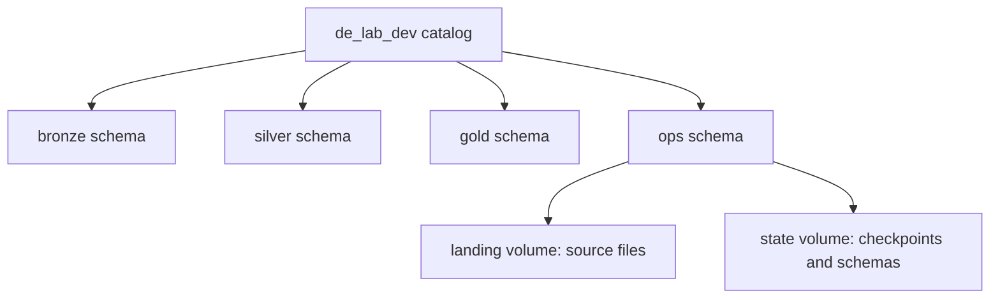

# 04. Catalogs, schemas, volumes, and minimum grants

Create the lab namespace and make its file paths usable by the workload.

## Data design and exact setup

**Catalog → Catalogs → Create catalog**: Catalog name `de_lab_dev`, Type **Standard catalog**, Storage location the approved `lab_managed` location/subdirectory. Click **Create → Configure catalog**. On **Workspaces**, bind the catalog to the development workspace. On **Permissions**, grant approved groups. On **Metadata**, add a comment and environment tag, then **Save**.

The SQL route below assumes a metastore managed location already exists. If not, add an approved `MANAGED LOCATION` to the catalog creation as described in chapter 03.

```sql
CREATE CATALOG IF NOT EXISTS de_lab_dev;
CREATE SCHEMA IF NOT EXISTS de_lab_dev.bronze;
CREATE SCHEMA IF NOT EXISTS de_lab_dev.silver;
CREATE SCHEMA IF NOT EXISTS de_lab_dev.gold;
CREATE SCHEMA IF NOT EXISTS de_lab_dev.ops;
CREATE VOLUME IF NOT EXISTS de_lab_dev.ops.landing;
CREATE VOLUME IF NOT EXISTS de_lab_dev.ops.state;
```

This managed landing volume is sufficient for manual lab uploads. For upstream ADLS delivery, create an **external** landing volume instead, before creating a managed volume with that name:

```sql
CREATE EXTERNAL VOLUME de_lab_dev.ops.landing
LOCATION 'abfss://de-lab@<storage-account>.dfs.core.windows.net/landing/orders-lab';
```

**Catalog → `de_lab_dev` → `ops` → Create → Volume**: Name `landing`, select Managed or External; for External select the location and edit the subdirectory. Click **Create**. Do not place an external table inside the directory governed by a volume.



## Governance and infrastructure automation

Replace the application-ID placeholder with the service principal application ID, enclosed in backticks in SQL. Grant `USE CATALOG` on `de_lab_dev`; `USE SCHEMA` on each required schema; `READ VOLUME` on landing; `READ VOLUME, WRITE VOLUME` on state; and `CREATE TABLE` on target schemas for first deployment. Existing targets need `SELECT, MODIFY`; table ownership may be needed for schema changes. Running an `IF NOT EXISTS` statement does not update ownership/grants.

Example, repeated for the required target schemas:

```sql
GRANT USE CATALOG ON CATALOG de_lab_dev TO `<application-id>`;
GRANT USE SCHEMA ON SCHEMA de_lab_dev.ops TO `<application-id>`;
GRANT READ VOLUME ON VOLUME de_lab_dev.ops.landing TO `<application-id>`;
GRANT READ VOLUME, WRITE VOLUME ON VOLUME de_lab_dev.ops.state TO `<application-id>`;
GRANT USE SCHEMA, CREATE TABLE ON SCHEMA de_lab_dev.bronze TO `<application-id>`;
GRANT SELECT, MODIFY ON SCHEMA de_lab_dev.bronze TO `<application-id>`;
```

Schema grants can inherit to current/future children; use table-level grants for tighter production scope. Readers get `USE CATALOG`, `USE SCHEMA` on gold and `SELECT` on approved gold objects, without bronze/state access. Avoid giving a consumer cloud IAM access to managed table files.

## Code push automation and maintenance

Bootstrap SQL and Terraform are admin-owned. Runtime code assumes the namespace exists. Bind production to production workspaces and deployment identities. Avoid using workspace-local groups in cross-workspace UC grants.

## Tests

Use **Catalog → object → Permissions** to inspect grants and `SHOW GRANTS ON VOLUME de_lab_dev.ops.landing`. Verify namespace traversal as well as leaf access. Test an engineer and a reader separately: a reader can query gold but cannot list state or modify silver.

## Official references

- [Create Catalog](https://docs.databricks.com/aws/en/catalogs/create-catalog)
- [Utility Commands](https://docs.databricks.com/aws/en/volumes/utility-commands)
- [Manage Privileges](https://docs.databricks.com/aws/en/data-governance/unity-catalog/manage-privileges)
- [Volume path rules](https://learn.microsoft.com/en-us/azure/databricks/volumes/paths)

[Guide index](../../DATABRICKS_GUIDE_INDEX.md)
