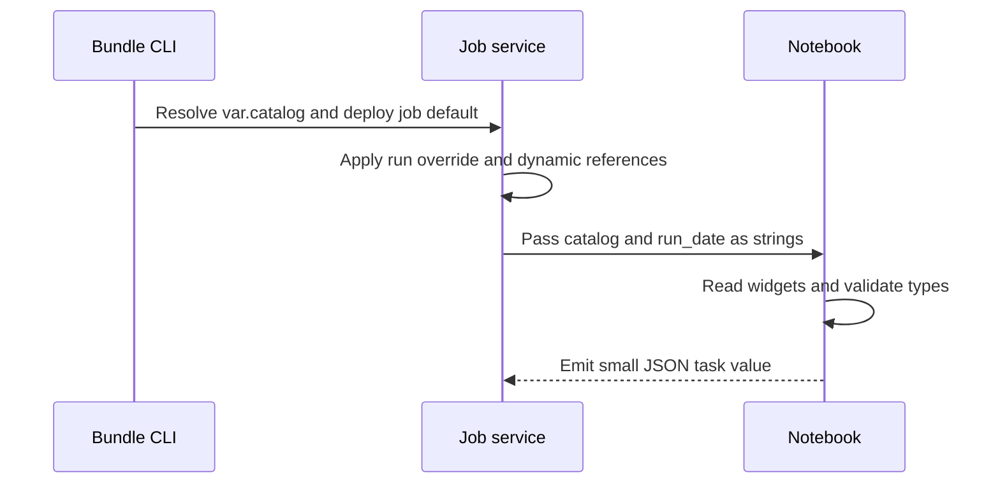

# 05. Parameters: which syntax belongs where

A concrete map of deployment values, runtime values, and notebook inputs.

## Data design

| Mechanism | Set it here | Read it here | Evaluated when |
|---|---|---|---|
| Bundle variable | YAML `variables`, target override, `--var`, `BUNDLE_VAR_catalog` | `${var.catalog}` in bundle YAML | Bundle command/deployment |
| Bundle substitution | Bundle metadata/resource references | `${bundle.target}`, `${resources.jobs.orders_daily.id}` | Bundle resolution |
| Job parameter | Job details → Edit parameters; run override | Pushed to compatible tasks | Each job run |
| Job dynamic reference | Task Parameters value | `{{job.parameters.catalog}}`, `{{job.run_id}}` | Job/task orchestration |
| Notebook widget | Widget API or Edit → Add parameter | `dbutils.widgets.get("catalog")` | Notebook execution; string |
| SQL named marker | SQL task Parameters or notebook widget | `:run_date`; `IDENTIFIER(:table_name)` for identifiers | Query binding |
| Task value | Upstream Python notebook `taskValues.set` | `{{tasks.ingest.values.rows}}` in task setting | After upstream task |
| Pipeline SQL parameter | Pipeline Parameters or update/task override | `:start_date` in SQL source | Pipeline update |
| Pipeline Python config | Pipeline Configuration map | `spark.conf.get("lab.source_path")` | Pipeline planning/execution |
| Python wheel arguments | Task keyword args or positional array | Function kwargs or `argparse` | Wheel execution |
| ADF expression | Notebook activity Base Parameters | Widget in Databricks | ADF activity run |

Example: bundle `${var.catalog}` is `de_lab_dev`; it becomes the saved job default. A run overriding `catalog=de_lab_sandbox` passes that value to a notebook. A notebook contains `dbutils.widgets.get("catalog")`, not a literal `{{job.parameters.catalog}}`. The orchestration service only resolves dynamic references in supported job fields, not arbitrary notebook strings.

## Governance and infrastructure automation

These mechanisms carry configuration, not authorization. Passing `catalog=de_lab_prod` does not grant production access. Do not pass passwords/API tokens through widgets, job parameters, pipeline configuration, or CI command-line arguments. Read secrets or use governed connections/credentials.

## Code push automation and maintenance

Keep environment defaults in bundle targets; keep business-run inputs as job parameters. Bundle-variable precedence is `--var`, then `BUNDLE_VAR_`, then target variable-overrides JSON, then target variables, then top-level default. For key-value tasks a job parameter wins over a same-name task parameter. JSON-array tasks need explicit dynamic references. Current pipeline SQL parameters can receive job pushdown; Python `spark.conf.get()` still reads Configuration, not those SQL parameters.

## Tests and common mistakes

Test run override precedence; missing required values; invalid ISO dates; the strings `false` and `0`; JSON-array parsing; and a misspelled dynamic reference arriving literally. Explicitly convert strings: `int(raw)` or `raw.lower() == "true"`; `bool("false")` is true in Python. Log only non-sensitive resolved values in your test environment.

## Official references

- [Variables](https://docs.databricks.com/aws/en/dev-tools/bundles/variables)
- [Job Parameters](https://docs.databricks.com/aws/en/jobs/job-parameters)
- [Task Parameters](https://docs.databricks.com/aws/en/jobs/task-parameters)
- [Parameters](https://docs.databricks.com/aws/en/ldp/parameters)

[Guide index](../../DATABRICKS_GUIDE_INDEX.md)
