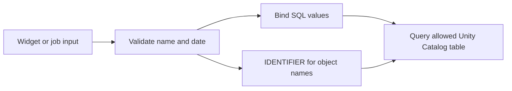

# 06. Notebook widgets and safe SQL parameter binding

Create inputs through buttons or code and use identifiers safely.

## Data design and buttons

**New → Notebook**, name `parameter_demo`, language Python. Attach supported compute. In **Edit → Add parameter**, fill **Parameter Name** `run_date`, **Widget Label** `Business date`, widget type Text, string parameter type where offered, default `2026-10-12`. Use the widget gear to edit settings. The API route:

```python
dbutils.widgets.text("catalog", "de_lab_dev", "Target catalog")
dbutils.widgets.text("run_date", "2026-10-12", "Business date")
dbutils.widgets.dropdown("mode", "incremental", ["incremental", "backfill"])
from datetime import date
import re
catalog = dbutils.widgets.get("catalog")
run_date = date.fromisoformat(dbutils.widgets.get("run_date")).isoformat()
if not re.fullmatch(r"[a-z][a-z0-9_]*", catalog):
    raise ValueError("Catalog must match the lab naming contract")
print({"catalog": catalog, "run_date": run_date})
```

All widget values are strings. UI labels can be friendly; the **Parameter Name** must match the task parameter key. Do not remove and recreate a widget in the same cell. For SQL-warehouse-attached notebooks create widgets through the UI.

For a SQL cell on compatible runtime (named widget markers are supported from DBR 15.2):

```sql
SELECT order_id, amount
FROM IDENTIFIER(:catalog || '.silver.orders_current')
WHERE order_date = CAST(:run_date AS DATE);
```

For Python on compatible Spark/Databricks runtime:

```python
result = spark.sql(
    "SELECT * FROM IDENTIFIER(:t) WHERE order_date = CAST(:d AS DATE)",
    args={"t": catalog + ".silver.orders_current", "d": run_date},
)
```

The table name is an identifier; the date is a value. Do not splice arbitrary input into f-string SQL or use `FROM :table_name` as if it were a bound identifier. Older runtime examples use different widget syntax; upgrade or follow that runtime's documented support instead of mixing syntaxes.



## Governance and infrastructure automation

Create an allowlist if callers can choose multiple catalogs. The example name regex prevents malformed names, but authorization still belongs to UC and the run-as principal. Do not grant broad production access just because input validation exists.

## Code push automation and maintenance

Widgets belong at notebook entry points. Put transformations in importable modules taking explicit typed inputs. A parent notebook may call `dbutils.notebook.run(path, timeoutSeconds, arguments)` for small ad hoc workflows; maintain production task dependencies through Jobs for separate retry/monitoring.

## Tests

Try a valid date, an impossible date, an empty catalog, and a SQL-looking catalog string. Verify that a job run's supplied value overrides the widget default. Preview the query against a disposable table; the local guide validates syntax/configuration but cannot validate Spark SQL execution without your workspace.

## Official references

- [Widgets](https://docs.databricks.com/aws/en/notebooks/widgets)
- [Databricks Utils](https://docs.databricks.com/aws/en/dev-tools/databricks-utils)
- [Notebook](https://docs.databricks.com/aws/en/jobs/notebook)

[Guide index](../../DATABRICKS_GUIDE_INDEX.md)
