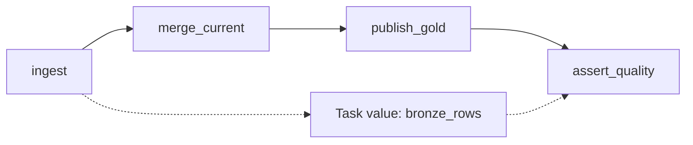

# 07. Lakeflow Jobs, dependencies, task values, and loops

Configure a job through the UI and connect the parameter flow to a reviewed bundle.

## Data design and buttons

**Jobs & Pipelines → Create → Job → Notebook**. Name the job `orders_daily`; Task name `ingest`; Type Notebook; Source Workspace; Path select the deployed `ingest_orders` notebook and **Confirm**. Choose Serverless when supported, or an approved job compute configuration. Click **Save task**.

In **Job details → Edit parameters**, add `catalog=de_lab_dev`, `run_date=2026-10-12`, `min_current_rows=2`; **Save**. Add a task-specific `job_run_id={{job.run_id}}` under the notebook's Parameters. `catalog` and `run_date` are job parameters; don't define different same-name task defaults and expect them to win.

Use **Add task → Notebook** to create `merge_current`, `publish_gold`, and `assert_quality`; set each **Depends on** to its predecessor, then **Save task**. Inspect the DAG. In job details configure Run as, concurrency `1`, a timeout suitable for the test, retries at task level, and approved failure notifications. Use the run menu **Run now with different parameters** to override the date for one run.



In upstream Python notebook:

```python
dbutils.jobs.taskValues.set(key="bronze_rows", value=42)
```

In downstream **Parameters**, Key `observed_bronze_rows`, Value `{{tasks.ingest.values.bronze_rows}}`. In notebook code call `dbutils.widgets.get("observed_bronze_rows")` and convert to integer. Task values carry small JSON (48 KiB limit), not DataFrames. Use a table/volume for larger payloads.

For a metadata-driven **For each** task, Inputs `["orders","customers"]`, concurrency `2`, nested notebook parameter `entity={{input}}`. For input objects such as `[{"entity":"orders","schema":"bronze"}]`, use `{{input.entity}}`. Add a dependency on the metadata task if Inputs is `{{tasks.discover.values.entities}}`. Only iterate an allowlisted entity contract. Do not run concurrent writers against one checkpoint or overlap updates to one pipeline.

## Governance and infrastructure automation

The job deployer and Run as identities can differ. The Run as service principal needs source-code, compute, volume, and table access. A job permission such as CAN_RUN does not confer table SELECT on the caller. Confirm run permissions and data permissions independently.

## Code push automation and maintenance

The checked-in `resources/orders.job.yml` is the source of truth after bundle deployment. UI experiments can be used to understand settings, but transfer approved changes into YAML to prevent later deployment reverting them. Use **Runs → Start time → task** to inspect resolved Parameters and Output. A repaired task can see changed data: save source snapshots if replay must be reproducible.

## Tests

Fail the merge deliberately in a disposable environment, repair it, and verify ingestion does not duplicate committed files. Test an unset task value and mismatched widget name. Test loop concurrency with disjoint targets. Assert output correctness after retry, not only a green job status.

## Scheduling and file-arrival fields

**Job details → Add trigger → Trigger type: Scheduled → Schedule type: Advanced**. Fill the period, starting time, and time zone; use **Show Cron Syntax** for Quartz syntax. Example daily 04:00 India time (a starting point to benchmark against a 06:00 deadline):

```yaml
# Add inside the job resource; keep paused until readiness is verified.
schedule:
  quartz_cron_expression: '0 0 4 * * ?'
  timezone_id: Asia/Kolkata
  pause_status: PAUSED
```

Simple scheduling uses an interval/unit and does not let you select the first-run time. Advanced scheduling does. Dynamic job date references are UTC; derive/pass the business date explicitly if it differs from UTC. Cron chooses a start time, not a guaranteed completion deadline.

For file arrivals use **Add trigger → File arrival**, **Storage location** `/Volumes/de_lab_dev/ops/landing/orders`, **Minimum time between triggers in seconds** `900`, and **Wait after last change in seconds** `60` as a lab example. **Test connection → Save**. Cooldown limits run frequency; wait-after-change debounces arrivals. A quiet period does not prove every expected file arrived: retain the source completion/reconciliation contract. Configure cloud events and UC access before assuming a trigger will work.

Current multiple-trigger support is Beta. Do not set a `triggers` list in the same request as legacy `schedule`, `trigger`, or `continuous` fields. The reference bundle intentionally has no automatic schedule; add a reviewed trigger after the fixture/access tests pass.

## Official references

- [Jobs Quickstart](https://docs.databricks.com/aws/en/jobs/jobs-quickstart)
- [Configure Task](https://docs.databricks.com/aws/en/jobs/configure-task)
- [Dynamic Value References](https://docs.databricks.com/aws/en/jobs/dynamic-value-references)
- [Task Values](https://docs.databricks.com/aws/en/jobs/task-values)

- [Run jobs on a schedule](https://docs.databricks.com/aws/en/jobs/scheduled)
- [File arrival trigger fields](https://docs.databricks.com/aws/en/jobs/file-arrival-triggers)
- [Trigger configuration and compatibility](https://docs.databricks.com/aws/en/jobs/triggers)

[Guide index](../../DATABRICKS_GUIDE_INDEX.md)
