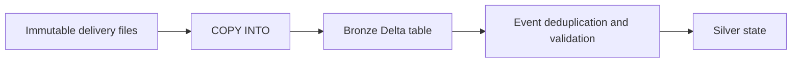

# 08. Batch files with COPY INTO

Load a bounded delivery with file-level replay tracking and a defined schema.

## Data design and exact fields

Use `COPY INTO` for manageable recurring batches with stable files and SQL-centric operations. For many files and evolving streaming ingestion use chapter 09. Upload the fixture via **Catalog → de_lab_dev → ops → landing → Upload to this volume**, placing it under `orders`. Alternatively use the CLI command in chapter 28.

From **SQL Editor**, select your lab SQL warehouse. Create the table and load:

```sql
CREATE TABLE IF NOT EXISTS de_lab_dev.bronze.orders_copy (
 event_id STRING, order_id STRING, sequence BIGINT, op STRING,
 event_time STRING, amount STRING, region STRING
) USING DELTA;
COPY INTO de_lab_dev.bronze.orders_copy
FROM '/Volumes/de_lab_dev/ops/landing/orders'
FILEFORMAT = JSON
FORMAT_OPTIONS ('mode' = 'PERMISSIVE')
COPY_OPTIONS ('mergeSchema' = 'false');
```

Keep this target separate from the Auto Loader job's `bronze.order_events`. File tracking prevents ordinary reloading of previously processed files, not duplication of business events across different files. Use immutable unique file names; rewriting a previously seen file is not a robust correction protocol. `force=true` forces reloading and can duplicate records; treat it as a deliberate recovery operation.



## Parameters

| Setting | Lab value | Meaning |
|---|---|---|
| `FILEFORMAT` | `JSON` | Fixture is newline-delimited JSON |
| `mode` | `PERMISSIVE` | Parsing behavior; preserve/review malformed data separately |
| `mergeSchema` | `false` | Do not silently evolve target schema |
| Source | `/Volumes/.../landing/orders` | Governed file path |
| Target | `de_lab_dev.bronze.orders_copy` | Explicit Delta destination |

For production validate malformed-record handling with your declared corrupt-record column and parser configuration. Parsing permissively is not equivalent to accepting bad records in silver.

## Governance, infrastructure, and CI/CD

Run as needs READ VOLUME, namespace USE privileges, and target write access. Govern upstream delivery identity separately. Store the SQL file and file naming contract in Git, run it through a SQL job task using the chosen warehouse, and promote the same file to dev/test/prod. Bootstrap the table before loading.

## Tests

Load once, record count, rerun unchanged files, and require the same count. Add a new file containing a repeated event; show that file tracking alone does not deduplicate it. Send a malformed line and inspect behavior. Reconcile accepted + quarantined rows to delivered rows, with duplicate accounting explicit.

## Official references

- [Copy Into](https://docs.databricks.com/aws/en/ingestion/cloud-object-storage/copy-into)
- [Utility Commands](https://docs.databricks.com/aws/en/volumes/utility-commands)
- [Configure Data Access](https://docs.databricks.com/aws/en/ingestion/cloud-object-storage/copy-into/configure-data-access)

[Guide index](../../DATABRICKS_GUIDE_INDEX.md)
