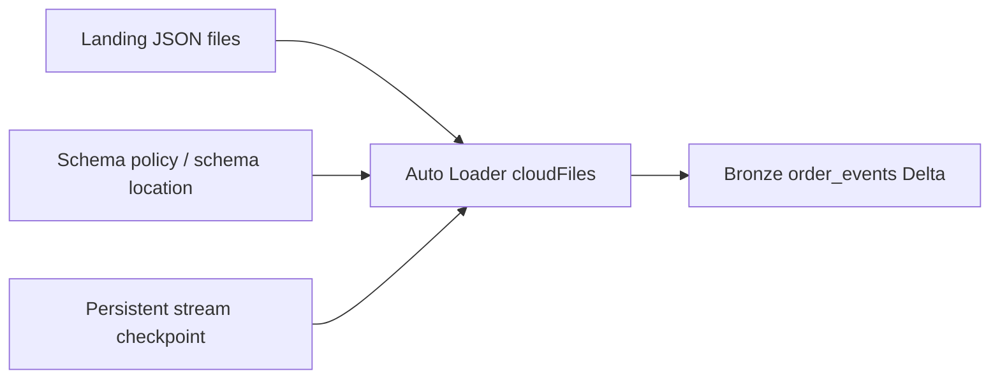

# 09. Auto Loader: schema, checkpoints, triggers, and replay

Incrementally ingest JSON files with a stable checkpoint and a deliberate schema policy.

## Data design

The worked job uses Auto Loader to append raw events. It retains duplicate business events and source operation codes; silver resolves state. Run as a bounded stream using `availableNow=True` on each scheduled run. The stream drains the available input then exits; this is not a continuously running stream.



Create **New → Notebook**, Name `ingest_orders`, Python. Paste the provided [notebook](../examples/notebooks/ingest_orders.py), attach compatible compute, and set widgets using the following values. In a Job task use these same keys; the source path is derived from `catalog` in the executable example to prevent crossing environments accidentally.

| Key/option | Example | Why |
|---|---|---|
| `catalog` widget | `de_lab_dev` | Derives target and volume paths |
| `cloudFiles.format` | `json` | Auto Loader source format |
| Declared schema | All source fields as STRING | Stable raw contract; cast in silver |
| `cloudFiles.schemaEvolutionMode` | `rescue` | Keep unexpected fields in rescued-data column |
| `cloudFiles.schemaLocation` | `.../state/orders_schema_v1` | Distinct schema metadata location |
| `rescuedDataColumn` | `_rescued_data` | Preserve unrecognized/type-inconsistent values |
| `cloudFiles.maxFilesPerTrigger` | `100` | Lab micro-batch file cap |
| `checkpointLocation` | `.../state/orders_bronze_v1` | Offset/progress state across job runs |
| Trigger | `availableNow=True` | Finish bounded processing |
| Target | `<catalog>.bronze.order_events` | Append-only raw table |

```python
raw = (spark.readStream.format("cloudFiles")
       .option("cloudFiles.format", "json")
       .option("cloudFiles.schemaLocation", schema_path)
       .option("cloudFiles.schemaEvolutionMode", "rescue")
       .option("rescuedDataColumn", "_rescued_data")
       .schema(raw_schema).load(source_path))
query = (raw.writeStream.option("checkpointLocation", checkpoint_path)
         .trigger(availableNow=True).toTable(target_table))
query.awaitTermination()
```

This excerpt's names are defined in the full notebook. A fresh checkpoint represents a fresh ingestion state and may replay old files. Do not add job run ID to the normal checkpoint path. Never let two active streams share a checkpoint.

## Governance and infrastructure automation

Protect the state volume from cleanup by a source-file retention job. Use file events only after cloud IAM and location setup; enabling a reader flag does not configure those permissions. The reference defaults to a straightforward directory-discovery lab, avoiding unconfigured cloud notification dependencies.

## Code push automation and maintenance

Keep schema and path version changes reviewable. An incompatible stream change may require a new checkpoint plus a controlled replay to a new target. With inferred schemas and `addNewColumns`, discovery of a new column can stop a stream after updating the schema; orchestrator retry resumes it. The reference uses explicit raw schema and rescue instead.

## Tests

Unchanged rerun adds zero rows; a new uniquely named file is consumed; an unknown column appears in rescued data; malformed input is inspected; failures before and after a batch commit do not create duplicate file commits with the same checkpoint. Test downstream business deduplication separately. Measure listing/discovery latency and throughput for realistic file counts.

## Official references

- [Schema](https://docs.databricks.com/aws/en/ingestion/cloud-object-storage/auto-loader/schema)
- [Api Options](https://docs.databricks.com/aws/en/spark/api-options)
- [Production](https://docs.databricks.com/aws/en/ingestion/cloud-object-storage/auto-loader/production)

[Guide index](../../DATABRICKS_GUIDE_INDEX.md)
