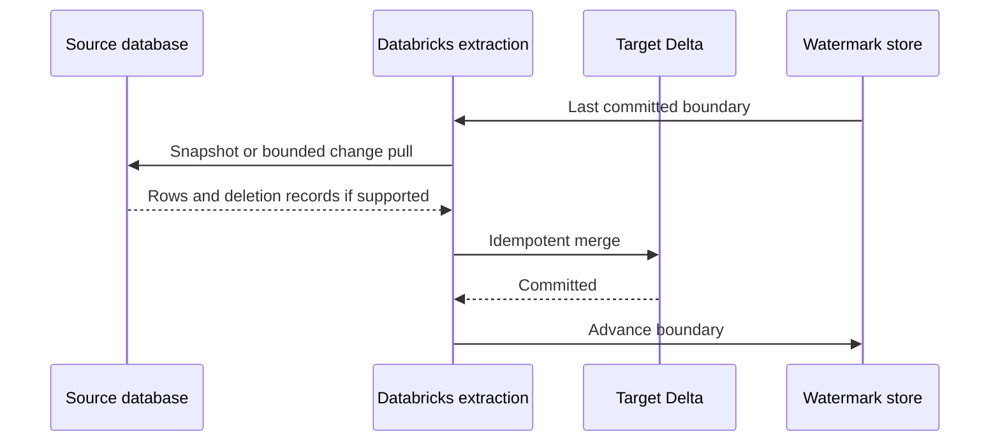

# 10. Database snapshots, JDBC, and incremental extraction

Understand source load, watermark correctness, and how deletes are represented.

## Data design

For an on-prem SQL Server/Oracle/PostgreSQL warehouse, begin with a consistent snapshot boundary. Later pulls need a change contract. A timestamp alone misses hard deletes; use database CDC, tombstone/soft-delete records, or complete scoped snapshot comparison. Never use absent rows from a partial API/database extract as delete evidence.

A portable classic-compute JDBC example uses a compatible installed driver and secrets. This is distinct from the newer governed JDBC connection feature:

```python
jdbc_url = "jdbc:postgresql://db.de.example:5432/sales?sslmode=verify-full"
lo, hi = "2026-10-11T00:00:00Z", "2026-10-12T00:00:00Z"
query = "(SELECT * FROM public.orders WHERE updated_at >= TIMESTAMPTZ '" + lo + "' AND updated_at < TIMESTAMPTZ '" + hi + "') AS batch"
# lo and hi here are fixed trusted ISO literals. Production code must validate
# timestamps and construct SQL for the source dialect; Spark args do not bind JDBC SQL.
df = (spark.read.format("jdbc").option("url", jdbc_url)
      .option("dbtable", query)
      .option("user", dbutils.secrets.get("de-lab", "db-user"))
      .option("password", dbutils.secrets.get("de-lab", "db-password"))
      .option("driver", "org.postgresql.Driver")
      .option("fetchsize", "10000").load())
```

Do not use unvalidated widget strings to build the query. Define the extraction interval in UTC; use overlap and deduplicate if source timestamps can arrive late. Advance your committed watermark only after the target commit succeeds. The pull and target commit are not a distributed transaction.



## Buttons and fields for governed JDBC

Current governed JDBC connections need supported runtime/SQL warehouse versions; docs specify DBR 19+ GA and older qualifying previews. **Catalog → Connect → Connections → Create connection**. Connection name `orders_jdbc`, Connection type **JDBC**, then **Next**. Fill **Url**, **Java dependencies** with JAR paths in a UC volume, **External options allow list**, and **Additional Options** for driver-specific user/password. Click **Create connection**. Use the linked feature documentation for its connection-based reader syntax; do not substitute these credentials into a plain JDBC URL.

| Tuning option | Starting value / caveat |
|---|---|
| `fetchsize` | `10000`, benchmark source memory/driver behavior |
| `numPartitions` | `4` only after source concurrency approval |
| `partitionColumn` | Numeric/date/timestamp distribution key |
| `lowerBound`, `upperBound` | Stride sizing, not row filters |
| `query` vs `dbtable` | Do not combine `query` with `partitionColumn`; use a subquery in `dbtable` |

## Governance, infrastructure, and CI/CD

Provision DNS/routing/firewall from compute to database; store credentials in a secret scope or governed connection. Install an approved driver via compute/job libraries; arbitrary JAR support differs across compute types. Keep watermark state with the pipeline owner, and use a single writer or transactional compare-and-set protocol.

## Tests

Test inserts, equal-timestamp rows, updates arriving after the boundary, source timezone differences, hard deletes, and failure between target commit and watermark update. Re-run the interval and require identical current state. Check source load under partitioned extraction. For lower-latency CDC prefer chapter 11 instead of frequent full scans.

## Official references

- [Jdbc Connection](https://docs.databricks.com/aws/en/connect/jdbc-connection)
- [Query Federation](https://docs.databricks.com/aws/en/query-federation)
- [Spark JDBC options](https://spark.apache.org/docs/latest/sql-data-sources-jdbc.html)

[Guide index](../../DATABRICKS_GUIDE_INDEX.md)
