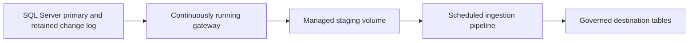

# 11. Lakeflow Connect: managed SQL Server CDC

Set up a managed ingestion gateway and pipeline, with log-retention tests.

## Data design and buttons

This recipe uses the standard gateway-based SQL Server architecture. Current docs also describe integrated CDC: that is a different one-pipeline design, not a reason to omit the gateway from this recipe. First have the DBA configure the source for the connector's supported change-tracking/CDC mode and retention. A primary source instance, UC, serverless availability, and approved network connectivity are prerequisites.

**Data Ingestion → Add data → Databricks connectors → SQL Server**. On **Connection**, select the approved `orders_sqlserver` UC connection or **Create connection** if permitted. On **Ingestion setup**, fill:

| Field | Lab choice |
|---|---|
| Ingestion pipeline name | `orders_sqlserver_ingest_dev` |
| Event log catalog/schema | `de_lab_dev.ops` |
| Auto full refresh for all tables | Off while validating recovery/history semantics |
| Ingestion gateway name | `orders_sqlserver_gateway_dev` |
| Staging catalog/schema | `de_lab_dev.ops` |

Click **Create pipeline and continue**. On **Source**, select the specific source order table. On its **Settings**, give an unambiguous destination name, and choose the intended **History tracking** mode. **Next → Save and continue**, then complete the destination catalog/schema selection and run/schedule settings presented by the wizard. Choose `de_lab_dev.bronze` as the destination; do not overwrite the worked file lab's tables.

## Parameters and alternatives

Standard CDC uses `ingestion_gateway_id`; integrated CDC uses `connection_name`, explicit `connector_type: CDC`, and its own data staging settings. Export/review the wizard's generated JSON for your supported connector version rather than merging fields from both architectures. Connector availability and features differ by source, cloud, and release.

History tracking preserves source changes in a type-2 target when supported. A full refresh can erase that history. Gateway extraction cadence and destination refresh cadence are separate; a scheduled destination does not mean the gateway can be turned off overnight.

## Governance and infrastructure automation

Creator needs source connection use, UC namespace/table/volume creation rights, and allowed gateway compute. The source DBA grants the documented database privileges; Databricks grants cannot enable CDC inside SQL Server. Private on-prem connectivity requires routes and DNS in the relevant execution plane. Monitor the staging area and source change-log retention.

## Code push automation and maintenance

Store reviewed exported definitions as connector-specific resources and promote through bundles/API/Terraform, with source/destination identifiers supplied per environment. Never manage the same pipeline with multiple deployment owners. Do not manually stop a healthy gateway as a cost experiment: missing source logs may force resnapshotting. Revisit integrated CDC as a separately tested alternative.

## Tests

Insert, update, delete, add supported columns, and restart destination updates while leaving extraction healthy. Reconcile source/target counts at a captured boundary. Simulate downtime within and beyond retention in an isolated source; prove alerting and documented resnapshot behavior. Assert that history survives ordinary restart and record what a full refresh discards.

## Official references

- [Sql Server Overview](https://docs.databricks.com/aws/en/ingestion/lakeflow-connect/sql-server-overview)
- [Sql Server Pipeline](https://docs.databricks.com/aws/en/ingestion/lakeflow-connect/sql-server-pipeline)

[Guide index](../../DATABRICKS_GUIDE_INDEX.md)
