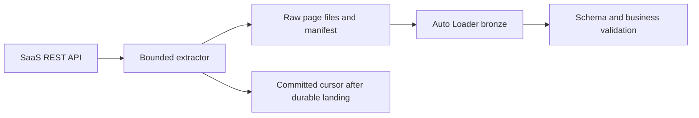

# 12. APIs and SaaS: pagination, limits, and durable landing

Extract outside Spark tasks when appropriate, then use the same governed file ingestion.

## Data design

Use a managed Lakeflow Connect SaaS connector when its supported object/authentication/incremental contract meets your need. Otherwise write a bounded driver-side extractor or run it in ADF/Airflow/a cloud function and land immutable raw responses. Spark is useful for transformations; creating one API call per row can overwhelm an external API and make retries multiply side effects.

## Exact input contract

| Parameter | Example | Rule |
|---|---|---|
| `endpoint` | `https://api.example.invalid/v1/orders` | Replace with your vendor; allowlist host |
| `page_size` | `500` | Within vendor limit |
| `cursor` | Vendor opaque cursor | Save exactly; do not invent offsets |
| `timeout_seconds` | `30` | Bound stalled calls |
| `max_pages` | `100` | Fail visibly when safety limit reached |
| `run_date` | `2026-10-12` | Business label, not deletion evidence |
| `landing_prefix` | `/Volumes/.../landing/api_orders` | Run/page-specific immutable names |
| Secret scope/key | `de-lab` / `vendor-token` | Never a widget value |

The template [api_extract.py](../examples/templates/api_extract.py) expects a vendor contract with `items` and `next_cursor`. Adapt these fields to the vendor's documented response. It bounds retries, handles 429/5xx, detects cursor loops, and writes a manifest only after pages land. Do not report a partially completed extract as a complete snapshot. Token expiry, cursor expiry, and rate-limit reset policies are vendor-specific.

## Buttons and fields

**New → Notebook**, name `extract_api_orders`, Python; install the reviewed pinned HTTP dependency in the notebook/job environment, restart Python if needed, and attach supported compute. Create widgets for non-sensitive fields above. In **Jobs & Pipelines**, add an extractor task preceding `ingest_api_orders`. Choose retries carefully: durable immutable page files and a final manifest enable safe reruns. UI does not provide a generic API ingestion form for every vendor; this route is custom code.

## Governance and infrastructure automation

Create a secret scope and scoped secret ACL through the CLI/admin workflow in chapter 18, or use a governed HTTP connection when supported. Configure egress/DNS to the API and vendor IP allowlists. Store raw responses under restricted access if they contain PII. For external writers to an external volume, cloud IAM must be approved independently.

## Code push automation and maintenance

Keep vendor-specific paging, authorization, and timestamp logic in a connector module. Pin a recorded contract fixture. Promote without changing the production cursor until durable commit/reconciliation. Treat 401/403 as an authentication/authorization incident instead of retrying blindly. A missing object from a filtered page is not a delete.

## Tests

Automate paginated happy path, empty page with next cursor, repeated cursor, timeout, 429 Retry-After, 500 exhaustion, token failure, and crash before manifest. Integration-test against the vendor sandbox and verify no cursor advance on partial failure. Reconcile extracted IDs, duplicates, and vendor-reported totals when provided.

## Official references

- 
- [Lakeflow Connect](https://docs.databricks.com/aws/en/ingestion/lakeflow-connect)
- [Databricks Utils](https://docs.databricks.com/aws/en/dev-tools/databricks-utils)

[Guide index](../../DATABRICKS_GUIDE_INDEX.md)
