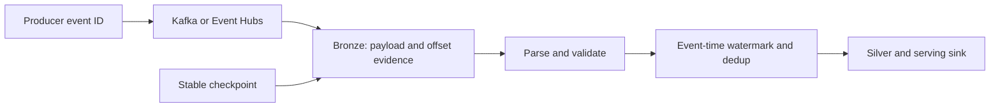

# 13. Kafka and Event Hubs: offsets, authentication, and sinks

Persist raw messages and use event-time logic without confusing it with ingestion time.

## Data design and exact options

Create notebook `kafka_to_bronze`; expose non-secret `bootstrap_servers`, `topic`, `catalog`, `checkpoint_path`. Persist `topic`, `partition`, `offset`, Kafka timestamp, key, and value. `(topic, partition, offset)` identifies a Kafka record; a business `event_id` identifies producer duplicates that can exist at different offsets.

```python
options = {
    "kafka.bootstrap.servers": "<namespace>.servicebus.windows.net:9093",
    "subscribe": "orders",
    "databricks.serviceCredential": "eventhubs_orders_reader",
    "startingOffsets": "earliest",
    "failOnDataLoss": "true",
    "maxOffsetsPerTrigger": "10000",
}
messages = spark.readStream.format("kafka").options(**options).load()
q = (messages.writeStream.option("checkpointLocation", checkpoint_path)
     .trigger(availableNow=True).toTable(catalog + ".bronze.kafka_orders"))
q.awaitTermination()
```

This service-credential route requires compatible runtime/cloud support and an administrator-created service credential with source permissions. Event Hubs' Kafka endpoint uses port 9093; `subscribe` is the Event Hub entity name. Once checkpointed, progress resumes from checkpoint, not the changed `startingOffsets` option. `earliest` reaches only retained records. The sample is bounded; for sustained low latency select a supported execution/trigger mode and benchmark it. Serverless trigger support differs from classic compute.



## Authentication alternatives

AWS MSK can use a UC service credential backed by IAM; Azure uses a service credential backed by the Access Connector identity; Confluent/ordinary Kafka can use TLS and SASL/PLAIN or SCRAM. These are different credentials. For service credentials, do not also set the manual SASL/authentication options prohibited by its documented route.

The custom SASL route uses shaded classes such as `kafkashaded.org.apache.kafka.common.security.plain.PlainLoginModule`. Store password/connection string in a secret. Do not install an old Event Hubs Spark JAR into a Lakeflow pipeline; its Kafka-compatible endpoint avoids that dependency. Some manual OAuth routes are unsupported on Standard/pipeline compute—check the linked auth requirements.

## Buttons, governance, and infrastructure automation

Have the administrator create the service credential in Catalog's credential workflow and grant workload use with the documented credential privilege. Configure source ACLs, source egress/private routing, and source retention. In the job's task settings select the Kafka notebook, pass the non-secret fields, use concurrency `1`, and bind its checkpoint to this logical stream.

## Code push automation and maintenance

Separate the Kafka bronze checkpoint from a silver stream checkpoint. Never use `failOnDataLoss=false` merely to make a failing stream green; determine which offsets expired. Sink writes through `foreachBatch` need idempotency, covered in chapter 16. Changing subscription/stateful logic requires recovery review.

## Tests

Produce duplicate event IDs, late events, poison JSON, schema changes, source retention loss, and a failure after a sink commit. Check both offset lag and event-time freshness. The expected guarantee is limited to source retention and sink semantics; checkpoints do not make every external delivery exactly once.

## Official references

- [Kafka](https://docs.databricks.com/aws/en/connect/streaming/kafka)
- [Authentication](https://docs.databricks.com/aws/en/connect/streaming/kafka/authentication)
- [Azure service credential authentication](https://learn.microsoft.com/azure/databricks/connect/streaming/kafka/authentication)
- [Event Hubs pipeline source](https://learn.microsoft.com/en-us/azure/databricks/ldp/event-hubs)

[Guide index](../../DATABRICKS_GUIDE_INDEX.md)
