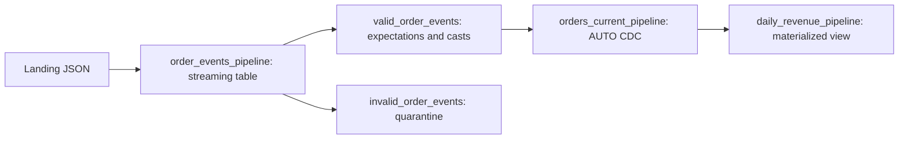

# 14. Lakeflow declarative pipelines: Python, SQL, and configuration

Build a managed DAG, with a deliberate choice of parameter mechanism.

## Data design and buttons

**New → ETL pipeline**. Name `orders_lakeflow_dev`; select default catalog `de_lab_dev`, schema `silver`; choose **Add existing assets** and attach [orders_pipeline.py](../examples/pipelines/orders_pipeline.py). Use Serverless where supported, Current channel, Triggered mode, and Advanced edition when using expectations. Existing workspaces may show legacy creation layouts; the current reference is linked below.

On pipeline monitoring **Settings**, inspect catalog/schema, source assets, compute, and **Run as**. For the Python example, edit **Configuration**:

| Configuration key | Value |
|---|---|
| `lab.source_path` | `/Volumes/de_lab_dev/ops/landing/orders` |
| `lab.schema_path` | `/Volumes/de_lab_dev/ops/state/lakeflow_orders_schema` |

Python reads `spark.conf.get("lab.source_path")`. A widget is not the configuration API for pipeline source code. The runtime manages dataset checkpoints; ordinary pipeline declarations do not call `writeStream.start()` or assign their own dataset checkpoint.

Pipeline functions return DataFrames. They may be evaluated multiple times during planning; do not send API requests, write files, call collect/count, or mutate external state inside dataset declarations. Use `from pyspark import pipelines as dp`. Older examples use `dlt`; update intentionally rather than changing just one import.

## SQL parameters versus Python Configuration

For a SQL-only asset, edit **Settings → Parameters → Edit**, add `source_catalog=de_lab_dev`, `start_date=2026-10-01`, then Save. Reference `:start_date` and `IDENTIFIER(:source_catalog || '.bronze.order_events')` in SQL. **Run with different settings** can override those parameters. Current job pipeline tasks can supply them and receive job-level parameter pushdown; Python config values are a different mechanism.

See [sql_parameter_pipeline.sql](../examples/pipelines/sql_parameter_pipeline.sql). It is a separate illustrative asset; don't add it to the Python example without also satisfying its input dependencies.

## Governance and infrastructure automation

Run as needs source access, target namespace use/create/write, and source-code access. In **Settings → Run as → Edit**, select the approved service principal and Save. One pipeline owns its published tables; do not perform ad hoc writes from another ingestion job. Schema/catalog settings determine defaults; fully qualified names can deliberately select other namespaces.

## Code push automation and maintenance

A separate checked-in pipeline bundle is under `examples/lakeflow_bundle/`; its outputs use `_pipeline` names to avoid the Jobs project. Use `configuration` for Python structural environment settings. Keep triggered runs initially; continuous operation requires tested latency/cost and recovery behavior. Test Preview channel separately before changing production Current-channel behavior.

## Tests

Run validation/update, open each dataset node and **Data quality** where available, inspect event log and quarantine. Verify a bad amount is rejected without losing bronze evidence. Test configuration missing keys, source permissions, and update retry. Do not promise incremental materialized-view refresh for every query; inspect the actual plan/update metrics.

## Official references

- [Configure Pipeline](https://docs.databricks.com/aws/en/ldp/configure-pipeline)
- [Python Ref](https://docs.databricks.com/aws/en/ldp/developer/python-ref)
- [Parameters](https://docs.databricks.com/aws/en/ldp/parameters)
- [Expectations](https://docs.databricks.com/aws/en/ldp/expectations)

[Guide index](../../DATABRICKS_GUIDE_INDEX.md)
