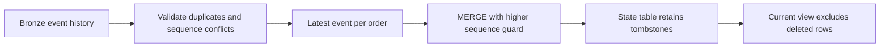

# 15. Ordered CDC, MERGE, hard deletes, and SCD history

Prevent retries and late updates from corrupting current state.

## Data design: source contract first

Each event has `event_id`, `order_id`, monotonically increasing per-order `sequence`, `op` in I/U/D, `event_time`, `amount`, and `region`. Ties with identical order/sequence but conflicting payload fail validation. An event ID repeated with different payload also fails. The lab uses full-record updates, not partial patches. Deletes may omit amount and region.

| Trap | Correct decision |
|---|---|
| MERGE gets two updates for one key | Reduce to one deterministic latest source row first |
| A delete removes all ordering evidence | Retain sequence/tombstone so an older update cannot resurrect it |
| Timestamp watermark used as CDC | Specify a separate deletion/change mechanism |
| Latest event row is invalid | Quarantine and raise an operational error; do not silently substitute older state |
| Streaming dedup forever | State retention is bounded; long-horizon duplicates need durable logic |



The Jobs lab uses `silver.orders_state` with an `is_deleted` flag and a current view. `MERGE` updates only when `s.sequence > t.sequence`. Insert even an unmatched delete as a tombstone. Thus sequence 3 delete prevents a late sequence 2 update from resurrecting an order. Equal sequence is a no-op only after conflict validation. Current revenue excludes tombstones.

The full merge notebook is [merge_current.py](../examples/notebooks/merge_current.py). It rebuilds the latest candidate state from complete bronze for a small educational lab; production should process bounded changes plus durable ordering/identity checks instead of rescanning unbounded history.

## AUTO CDC alternative and exact parameters

Inside a Lakeflow Python pipeline:

```python
dp.create_streaming_table("orders_current_pipeline")
dp.create_auto_cdc_flow(
    target="orders_current_pipeline", source="valid_order_events",
    keys=["order_id"], sequence_by="sequence",
    apply_as_deletes="op = 'D'",
    except_column_list=["op", "event_id", "_rescued_data"],
    stored_as_scd_type=1,
)
```

For type 2 use `stored_as_scd_type=2` and a deliberate `track_history_column_list`; configure tombstone retention beyond maximum expected late arrival. `ignore_null_updates=True` implements a partial-update interpretation, not the full-record semantics of the lab. Composite ordering can use `struct(...)` only if the source contract defines its ordering. If supplying an explicit SCD target schema include the required start/end metadata columns of matching sequence type.

## Buttons, governance, and infrastructure automation

For AUTO CDC use the pipeline editor/assets and Configuration from chapter 14. For custom MERGE use a notebook task downstream of ingestion. Workload owns silver write access; consumers receive SELECT on the current view. Bronze retention and tombstone retention are operational dependencies.

## Code push automation and maintenance

Keep one target writer, separate deployment environments, and version the source-event contract. MERGE semantics vary by runtime (DBR 16+ changed duplicate-match evaluation). Always make source uniqueness explicit. For SCD2 choose inclusive start/exclusive end intervals, which attributes create new versions, and how deletes close validity.

## Tests

Retry the same batch; reorder arrivals; send insert→update→delete then a late update; send conflicting same-sequence payloads; delete a never-seen key; change the schema; and backfill events older than retention. SCD2 assertions include no overlapping validity intervals and at most one active version per key. Local tests cover the reference rules; verify actual Delta/AUTO CDC behavior in workspace tests.

## Official references

- [Merge](https://docs.databricks.com/aws/en/delta/merge)
- [Ldp Python Ref Apply Changes](https://docs.databricks.com/aws/en/ldp/developer/ldp-python-ref-apply-changes)
- [Cdc](https://docs.databricks.com/aws/en/ldp/cdc)

[Guide index](../../DATABRICKS_GUIDE_INDEX.md)
