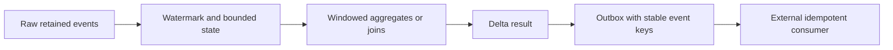

# 16. Watermarks, state, streaming joins, and external sink delivery

Make late-data and retry behavior explicit instead of relying on an exactly-once label.

## Data design and parameters

After preserving raw input, parse event timestamps and enforce a late-arrival contract. A watermark controls bounded state; it is not the job's batch-extraction watermark and not a deletion detector.

```python
parsed = bronze.withColumn("event_time", F.to_timestamp("event_time_raw"))
unique = (parsed.withWatermark("event_time", "2 hours")
          .dropDuplicatesWithinWatermark(["event_id"]))
```

Use `dropDuplicatesWithinWatermark` only on a supported runtime/Spark version. This reduces duplicate events within the state horizon. It cannot guarantee indefinite deduplication after keys are evicted. Persist raw events and use an explicit policy for data beyond the supported lateness window.

For a stream-stream join, put event-time watermarks on both streams and a bounded time predicate—for example payment time between order time and order time + 1 hour. Otherwise state can grow without bound. A stream-static join's lookup freshness is a separate design question: it is not automatically a temporal as-of join.



## External write contract

`foreachBatch` gives at-least-once callbacks. A JDBC append, API side effect, or two-table write is not made atomic by a Spark checkpoint. Design an idempotent sink with stable event keys, transactional staging + merge, or an outbox with acknowledgements. If a sink commits then the callback crashes, retry must not double-apply the business effect.

For Delta batch writes, `txnAppId` plus `txnVersion` can identify a retried write when used with the supported write API; retain the same app ID for the same checkpoint lineage. A new checkpoint resets batch IDs and therefore needs a new app ID. That mechanism does not provide a transaction spanning multiple tables or apply arbitrary MERGE CDC semantics automatically.

## Buttons, governance, and infrastructure automation

For custom streaming notebooks configure a Jobs task with the supported compute/trigger mode and a stable checkpoint path. Inspect query progress (input rows, processed rows/second, batch duration, state rows, watermark) through the stream UI/metrics. Allow only the sink-writing workload to consume the outbox and access the external credentials.

## Code push automation and maintenance

Changing stateful operators, grouping keys, or schema can be incompatible with a checkpoint. Test in a new state namespace, replay retained bronze, reconcile, and cut consumers over deliberately. Don't delete the live checkpoint to resolve an unexplained error. Tune `maxOffsetsPerTrigger` or file limits to measured micro-batch capacity; they are not source retention settings.

## Tests

Cover duplicate IDs at different timestamps, events just within/outside lateness, an idle stream in a join, hot-key skew, restart with unchanged code, and failure after external commit. Automate replay invariants and external sink idempotency in a test service. Measure how late events affect aggregates and how corrections reach already published results.

## Official references

- [Foreach](https://docs.databricks.com/aws/en/structured-streaming/foreach)
- [Delta Lake](https://docs.databricks.com/aws/en/structured-streaming/delta-lake)
- [Spark Structured Streaming guide](https://spark.apache.org/docs/latest/streaming/apis-on-dataframes-and-datasets.html)

[Guide index](../../DATABRICKS_GUIDE_INDEX.md)
