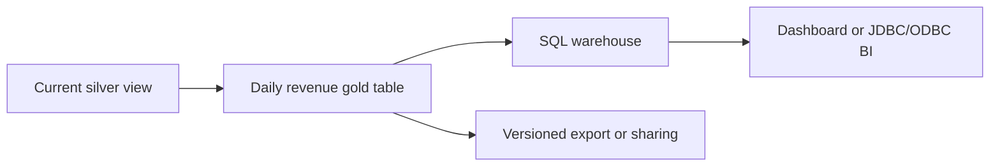

# 17. Gold tables, SQL warehouses, dbt, and exports

Publish reconciled results with a clear refresh and serving contract.

## Data design and exact query

The Jobs lab computes gold from the current view, so deleted orders are excluded. The date is the current order event's UTC date; in a real product choose placed-date versus updated-date semantics before designing revenue. Using an event's changed date as sales date without agreement is a business-definition error.

```sql
SELECT order_date, region,
       COUNT(*) AS order_count,
       SUM(amount) AS revenue
FROM de_lab_dev.silver.orders_current
GROUP BY order_date, region;
```

The provided job rewrites the small managed gold table from complete current state to make retries deterministic. For large tables use a reviewed incremental partition/merge strategy and recompute affected old and new groups. An order moving between dates/regions requires both groups to change. Empty-group cleanup matters.



## Buttons and fields

**SQL Warehouses → Create SQL warehouse**, Name `de-lab-sql`, serverless if supported, allowed size and auto-stop; Create. In **SQL Editor**, choose that warehouse, save query `daily_revenue_check`, and query the gold table. Add parameters `start_date`, `end_date`, `region` only if the query needs them:

```sql
SELECT * FROM de_lab_dev.gold.daily_revenue
WHERE order_date >= CAST(:start_date AS DATE)
  AND order_date < CAST(:end_date AS DATE)
  AND region = :region;
```

Use SQL task Parameters keys matching these names. A Python notebook's compute cannot be assumed to be the SQL warehouse. A dbt task uses dbt commands/profile/warehouse configuration; its model variables and Jinja syntax are separate from Databricks job runtime references.

## Loading alternatives

Managed Delta tables are the reference destination. Use external Delta only when you need externally managed lifecycle and an approved location. JDBC to operational systems needs staging/merge and source load tests; arbitrary append on retries duplicates. For object exports specify stable business batch IDs, a manifest, and consumer cutover rather than overwriting partially visible files. Lakehouse Federation reads an external database; it is not a write sink.

## Governance and infrastructure automation

Readers need warehouse CAN_USE and catalog/schema USE + table/view SELECT. A dashboard's execution/credential sharing mode affects whose permissions are evaluated; test the actual consumer identity. Propagate masking and approved aggregate disclosure rules to exports, not just the notebook preview.

## Code push automation and maintenance

Version SQL/dbt models, tests, and metric definitions. Deploy SQL warehouse/platform settings through Terraform; application queries/jobs through the chosen application deployment owner. Add a reconciliation task before making a new dataset visible to consumers.

## Tests

Revenue must equal the sum of current non-deleted orders per day/region, with decimal arithmetic. Test corrections moving an order to another group, all orders deleted, and null dimensions. Benchmark concurrent BI queries and freshness after updates. Verify unauthorized readers fail and approved readers see only expected columns/regions.

## Official references

- [Create Sql Warehouse](https://docs.databricks.com/aws/en/sql/admin/create-sql-warehouse)
- [Task Parameters](https://docs.databricks.com/aws/en/jobs/task-parameters)
- [Query Federation](https://docs.databricks.com/aws/en/query-federation)
- [Ci Cd](https://docs.databricks.com/aws/en/dev-tools/ci-cd)

[Guide index](../../DATABRICKS_GUIDE_INDEX.md)
