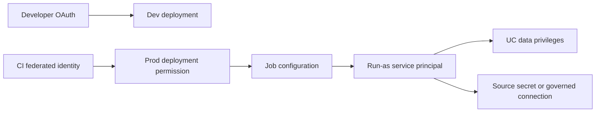

# 18. Secrets, service principals, Run as, and authentication

Separate deployment identity, execution identity, and source-system credentials.

## Data design and buttons

A human deploys in dev using OAuth login. CI deploys as an automation service principal. A production job runs as a service principal with data privileges. Source API/database secrets are different again. Never assume one credential solves all four.



In the account console's identity management, create/choose a service principal and assign it to the workspace. Record its **application ID** for auth/SQL grants and **numeric service-principal ID** for the federation-policy API; they are not interchangeable. The deployer must be permitted to use the execution service principal.

In the job details, edit **Run as**, select the service principal, and save. Check future run details show that identity. For pipelines use **Settings → Run as → Edit**. Give it access to bundle-deployed code plus its UC sources/targets. Job ownership and run identity are distinct.

## CLI and exact fields

```sh
databricks auth login --host 'https://<workspace-host>' --profile de-lab
databricks current-user me --profile de-lab
databricks secrets create-scope de-lab --profile de-lab
databricks secrets put-secret de-lab vendor-token --profile de-lab
```

The last command prompts for the secret; enter it interactively, do not include a real token in a shell script. Read it with `dbutils.secrets.get("de-lab", "vendor-token")`. Secret redaction is an aid, not a guarantee against transformed/logged secret leakage. Scope ACLs and source permissions must be reviewed. A reader of a secret-enabled workload may need restrictions even if they cannot see the raw secret.

For OAuth M2M in a CI runner set `DATABRICKS_HOST`, `DATABRICKS_CLIENT_ID`, `DATABRICKS_CLIENT_SECRET`, `DATABRICKS_AUTH_TYPE=oauth-m2m` from the runner's protected variables. Prefer workload federation when supported. Do not invoke `auth login` interactively in CI.

## Governance and infrastructure automation

Use managed identities/service credentials for cloud source services and storage credentials for cloud storage where supported. Credential scope, workload workspace assignment, UC grants, compute permissions, network access, and external source ACLs are independent. Rotate fallback secrets and revoke unused principals.

## Code push automation and maintenance

Bundle `run_as.service_principal_name` is the service principal application ID, not a display name guessed from the UI. A different deploy identity needs permission to set that run identity. Keep production bundle deployment roots stable; changing them can create additional resources instead of updating the intended resources.

## Tests

Run a notebook as the principal, prove it can read/write required objects, and prove it cannot use another team's secret or catalog. Delete/disable a disposable human owner after transferring automation ownership and verify the principal's job continues. Test credential rotation and expired-source-token behavior without exposing tokens in test artifacts.

## Official references

- [Service Principals](https://docs.databricks.com/aws/en/dev-tools/auth/service-principals)
- [Oauth M2M](https://docs.databricks.com/aws/en/dev-tools/auth/oauth-m2m)
- [Run As](https://docs.databricks.com/aws/en/dev-tools/bundles/run-as)
- [Secrets](https://docs.databricks.com/aws/en/security/secrets)

[Guide index](../../DATABRICKS_GUIDE_INDEX.md)
