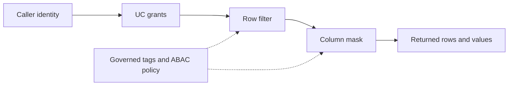

# 19. Governance: row filters, masking, lineage, tags, and ABAC

Implement a small explicit policy before scaling policy administration.

## Data design and exact SQL

Use a SQL UDF registered in Unity Catalog for each table policy. This example restricts non-admin readers to India and masks email unless the caller belongs to the PII-reader account group. These are policy examples for a disposable `customers` table, not prerequisites for the orders lab.

```sql
CREATE FUNCTION de_lab_dev.ops.region_filter(r STRING)
RETURNS BOOLEAN
RETURN is_account_group_member('de_lab_admins') OR r = 'IN';
CREATE FUNCTION de_lab_dev.ops.email_mask(e STRING)
RETURNS STRING
RETURN CASE WHEN is_account_group_member('de_lab_pii_readers')
            THEN e ELSE '***' END;
ALTER TABLE de_lab_dev.silver.customers
SET ROW FILTER de_lab_dev.ops.region_filter ON (region);
ALTER TABLE de_lab_dev.silver.customers
ALTER COLUMN email SET MASK de_lab_dev.ops.email_mask;
```

The table/function must exist and UDF types must match column types. Use compatible compute; Dedicated fine-grained reads/writes have additional runtime/serverless requirements. Policies can change query plans; measure their cost.

## Buttons and fields

**Catalog → table → Overview → Row filter → Add filter**. Select catalog `de_lab_dev`, schema `ops`, function `region_filter`; bind its argument to table column `region`; **Add**. For email in the column list, use the **Mask** edit icon, choose `email_mask`, bind any additional arguments, and **Add**. Create the SQL function before using the UI selector.



## Governance and infrastructure automation

Table policies require the documented function EXECUTE/namespace rights and table ownership or qualifying MANAGE/SELECT permissions. Restrict policy creation and the ability to bypass raw storage. Tags alone classify metadata; a policy must use them to enforce access.

ABAC scales row-filter/mask policies using governed tags, scoped at approved catalog/schema/table levels. Current docs also describe GRANT policies and Beta metastore-level/DENY capabilities. Gate these on supported runtime/workspace and current feature requirements; do not present Beta policy variants as a universal stable baseline. Choose table policy for an explicit narrow exception and centralized ABAC for consistent tagged assets, after testing conflicts/overrides.

Use **Catalog → object → Lineage** to inspect supported tracked dependencies. Lineage is not evidence of every external Python/API side effect; annotate those edges in your documentation. Collect audit events and review grants as part of deployment evidence.

## Code push automation and maintenance

Version UDF definitions, grants, tag taxonomy, and policy migrations separately from transformation code. Removing/changing a referenced function can break table access. Remove or replace references safely before dropping a function. Test preservation of policies across table replacement/schema migration.

## Tests

Use two real test identities/groups; do not simulate policy results using only the owner's notebook. Assert allowed rows/columns and denied access. Test null region/email, wrong argument types, group changes, UI policy removal, replacement retaining policies, export paths, and query performance with/without policy on representative data.

## Official references

- [Manually Apply](https://docs.databricks.com/aws/en/data-governance/unity-catalog/filters-and-masks/manually-apply)
- [Abac](https://docs.databricks.com/aws/en/data-governance/unity-catalog/abac)
- [Single User Fgac](https://docs.databricks.com/aws/en/compute/single-user-fgac)
- [Manage Privileges](https://docs.databricks.com/aws/en/data-governance/unity-catalog/manage-privileges)

[Guide index](../../DATABRICKS_GUIDE_INDEX.md)
