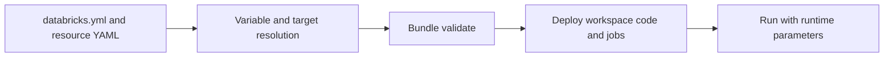

# 20. Bundles: variables, targets, resources, and deployment commands

Deploy the same reviewed job to separate environments with explicit runtime inputs.

## Data design and exact file layout

`examples/databricks.yml` is the bundle root; `resources/orders.job.yml` holds the four-task job. Targets `dev` and `prod` provide `catalog` and `workspace_host`; production additionally requires `run_as_sp`. The example uses serverless notebook tasks; choose the classic template when serverless is unavailable.



From the repository:

```sh
cd databricks_guide/examples
databricks auth login --host 'https://<dev-workspace-host>' --profile de-lab
export BUNDLE_VAR_workspace_host='https://<dev-workspace-host>'
databricks bundle validate -t dev --profile de-lab
databricks bundle deploy -t dev --profile de-lab
databricks bundle run orders_daily -t dev --profile de-lab \
  --params 'catalog=de_lab_dev,run_date=2026-10-12,min_current_rows=2'
```

`--var catalog=de_lab_other` is a deployment variable override; `--params catalog=de_lab_other` is a job-run override. Use the same deployment variables whenever inspecting/updating the deployed resource state. Shell environment variables are read by the CLI, not automatically by the job's remote Python process.

| Bundle field | Meaning |
|---|---|
| `bundle.name` | Stable application identity |
| `include` | Resource YAML files to load |
| `variables.catalog.default` | Base value |
| `targets.dev.mode` | Development isolation behavior |
| `targets.prod.mode` | Production validation behavior |
| `workspace.host` | Target workspace endpoint |
| `workspace.root_path` | Stable deployment state/code root |
| `resources.jobs.orders_daily.parameters` | Saved runtime parameter defaults |
| `run_as.service_principal_name` | Execution application ID |

Dev mode may prefix resource names and pause schedules for experimentation. Production mode validates production settings. A path that varies by human deployer is unsuitable for a single shared production deployment. The reference uses `/Workspace/Shared/.bundle/orders_lab/prod` for the production root; ensure only the deployment owner can mutate it.

## Buttons and review

After deployment, use **Jobs & Pipelines**, find the prefixed development job or named production job, inspect Tasks/Parameters/Run as, and compare to YAML. **Runs → task → Parameters** shows resolved run values. Bundle schema is available without cloud execution using `databricks bundle schema`; `bundle validate` adds workspace-aware validation and authentication.

## Governance and infrastructure automation

Run platform bootstrap first; bundles do not grant all UC/cloud privileges simply because a job exists. Distinguish resource permissions in bundle YAML from UC SQL/Terraform grants. Avoid Terraform and bundles both owning the same job.

## Code push automation and maintenance

Pin the tested CLI in CI. Validate → deploy → integration-test → promote. Production commands use the prod workspace host and principal. Treat `bundle destroy` as deletion, not rollback; do not run it against production to revert a code commit. Redeploy a previous reviewed code version instead and separately address data/schema rollback.

## Tests

Local schema checks catch YAML shape/field errors; authenticated validation catches target/resource/access issues. Inspect file path existence and DAG references. Execute a dev job twice with fixture input, confirm stable results, and require a remote integration result before promotion. Templates remain examples until your actual IDs/network/grants are supplied.

## Official references

- [Variables](https://docs.databricks.com/aws/en/dev-tools/bundles/variables)
- [Deployment Modes](https://docs.databricks.com/aws/en/dev-tools/bundles/deployment-modes)
- [Examples](https://docs.databricks.com/aws/en/dev-tools/bundles/examples)
- [Run As](https://docs.databricks.com/aws/en/dev-tools/bundles/run-as)

[Guide index](../../DATABRICKS_GUIDE_INDEX.md)
