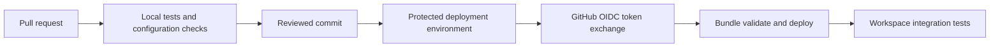

# 21. GitHub Actions deployment with workload identity federation

Configure exact trust fields and runner variables; keep deployment opt-in.

## Data design and delivery flow



The active repository workflow validates the guide locally and never connects to Databricks. The deployment example is deliberately under `examples/templates/`, so pushing this educational branch does not create cloud resources. To activate it in your application repo, complete the identity/environment setup and copy the reviewed template into `.github/workflows/`.

## Buttons and exact trust fields

In Databricks account console select the deployment service principal and configure a federation policy using the documented policy workflow/API. Fill:

| Policy field | Value |
|---|---|
| Issuer URL | `https://token.actions.githubusercontent.com` |
| Entity type | Environment |
| Organization/user | Your GitHub owner, here `sk03167` |
| Repository | Your application repository |
| Environment | `databricks-dev` or `databricks-prod` |
| Subject | `repo:<owner>/<repo>:environment:databricks-dev` |
| Audience | Your Databricks account ID |
| Subject claim | `sub` |

The subject must match case and entity type. A branch subject and an environment subject are different. Use the numeric service-principal ID for policy creation; use its application/client UUID for CLI authentication.

GitHub repository **Settings → Environments → New environment**: Name `databricks-dev`; configure permitted branches and reviewers according to your promotion policy. Under environment variables add `DATABRICKS_HOST`, `DATABRICKS_CLIENT_ID`, and `DATABRICKS_RUN_AS_SP` (execution application ID for prod). Add a separate prod environment with its prod host, least-privilege principal, and protection rules.

The workflow requires:

```yaml
permissions:
  contents: read
  id-token: write
# In the deployment job:
environment: databricks-dev
env:
  DATABRICKS_AUTH_TYPE: github-oidc
  DATABRICKS_HOST: ${{ vars.DATABRICKS_HOST }}
  DATABRICKS_CLIENT_ID: ${{ vars.DATABRICKS_CLIENT_ID }}
```

From `databricks_guide/examples`, run `bundle validate`, `bundle deploy`, then `bundle run orders_daily --params ...` using the same target and deployment variables. Preinstall the reviewed pinned CLI version on the runner or use a reviewed pinned setup action, not an unaudited mutable script. The template assumes the CLI is already available on your managed runner.

## Governance and infrastructure automation

Constrain the federation policy to a single protected environment. Give the deployment principal application-resource permissions; give execution principal data permissions. Grant the deployer permission to use the execution principal. Bootstrap UC and cloud IAM separately. Avoid privileged deployment on untrusted fork pull requests.

## Code push automation and maintenance

Use a deployment concurrency group per target with cancellation off for in-flight mutation. Record source SHA, CLI version, target, and run URL. Pin action commits and Python/Node packages. Promote the same tested commit to prod. Cloud tests cost money; a local PR check is not a substitute for them.

## Tests

Confirm `databricks current-user me` resolves the expected principal before deployment. Test wrong subject/environment failing token exchange. Test a missing UC privilege fails the integration task. Require fixture rerun idempotency, quality checks, and consumer access checks before promotion. Revoke the test policy and verify access ends.

## Official references

- [Provider Github](https://docs.databricks.com/aws/en/dev-tools/auth/provider-github)
- [Github](https://docs.databricks.com/aws/en/dev-tools/ci-cd/github)
- [Ci Cd](https://docs.databricks.com/aws/en/dev-tools/bundles/ci-cd)

[Guide index](../../DATABRICKS_GUIDE_INDEX.md)
