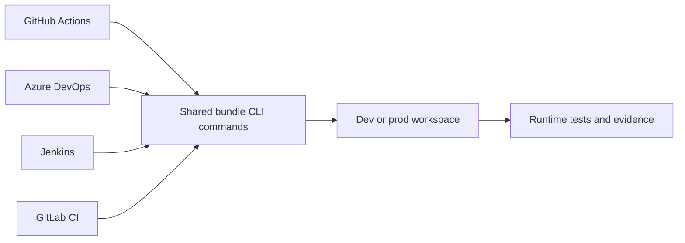

# 22. Azure DevOps, Jenkins, GitLab, and orchestration alternatives

Use equivalent validation and deployment stages with different runners and identity adapters.

## Data design

The deployment semantics stay the same: test code → authenticate → validate bundle → deploy → run workspace assertions → promote. A CI vendor replacement changes runner configuration and identity, not the business event ordering or table model.

## Exact settings per runner

| System | UI/settings to create | Runner values | File |
|---|---|---|---|
| Azure DevOps | Pipelines → New pipeline → Existing Azure Pipelines YAML; Library → Variable group; Environments for protected production stage | `DATABRICKS_HOST`, `DATABRICKS_CLIENT_ID`; choose documented federation/service connection or protected OAuth secret | `azure-pipelines.example.yml` |
| Jenkins | New Item → Pipeline; Pipeline from SCM; approved credential bindings; environment-specific executor/agent | Host/client ID plus protected OAuth M2M secret if federation isn't configured | `Jenkinsfile.example` |
| GitLab | Settings → CI/CD → Variables; protect prod variables and environment; restricted deploy branch/rules | Unified-auth vars; use documented federation for your IdP or masked OAuth M2M fallback | `gitlab-ci.example.yml` |
| Airflow | Approved Databricks connection and provider; DAG deployment | Run an already deployed Databricks job; keep deployment ownership separate | Application DAG |
| ADF | Azure Databricks linked service + Notebook activity or reviewed Jobs API call | Notebook Base Parameters, activity outputs | Chapter 29 |

A generic OAuth fallback sets `DATABRICKS_AUTH_TYPE=oauth-m2m`, host, client ID, and client secret in the runner's protected secret system. Do not call this OIDC. Conversely GitHub's `github-oidc` adapter does not automatically work on Jenkins/Azure DevOps/GitLab. Use the matching documented federation adapter and trust policy.

## Commands and parameter flow

Templates under `examples/templates/` assume a pinned CLI is preinstalled and local checks have passed. Working directory must be the bundle root. Stage values set `BUNDLE_VAR_workspace_host` and `BUNDLE_VAR_catalog`; production sets `BUNDLE_VAR_run_as_sp`. Job values are passed via `bundle run --params`, not a mixture of vendor interpolation syntaxes pasted into notebooks.

Keep one scheduler for a given job. Scheduling in both Airflow and Databricks can create duplicate runs. Set `max_concurrent_runs=1` when writers share state; external orchestrators should use stable request idempotency tokens and poll the actual run result.

## Governance and infrastructure automation

Managed runners need network access to the workspace endpoint and package sources; remote compute needs separate data-source connectivity. Apply environment protection, source-branch constraints, masked credentials, and minimal permissions. Terraform infrastructure stages use separate identities/state from application bundle deployment.

## Code push automation and maintenance

Centralize reusable CLI scripts to avoid four subtly different deployment procedures. Review generated resource changes, archive deployment evidence, and rotate/revoke credentials. Pin provider/action/agent versions. Maintain a separate workflow for schema migrations; replay and code rollback are not interchangeable.

## Tests

Run the same golden business fixture through every chosen CI route, compare output table state, and prove a failed quality gate stops promotion. Test secret redaction, failed auth, job timeout, runner interruption after deployment, and serialization of concurrent deployments. These are template examples; no vendor pipeline or Databricks deployment was executed during authoring.

## Official references

- [Azure Devops](https://docs.databricks.com/aws/en/dev-tools/ci-cd/azure-devops)
- [Oauth M2M](https://docs.databricks.com/aws/en/dev-tools/auth/oauth-m2m)
- [Ci Cd](https://docs.databricks.com/aws/en/dev-tools/ci-cd)
- [Jobs](https://docs.databricks.com/aws/en/jobs)

[Guide index](../../DATABRICKS_GUIDE_INDEX.md)
