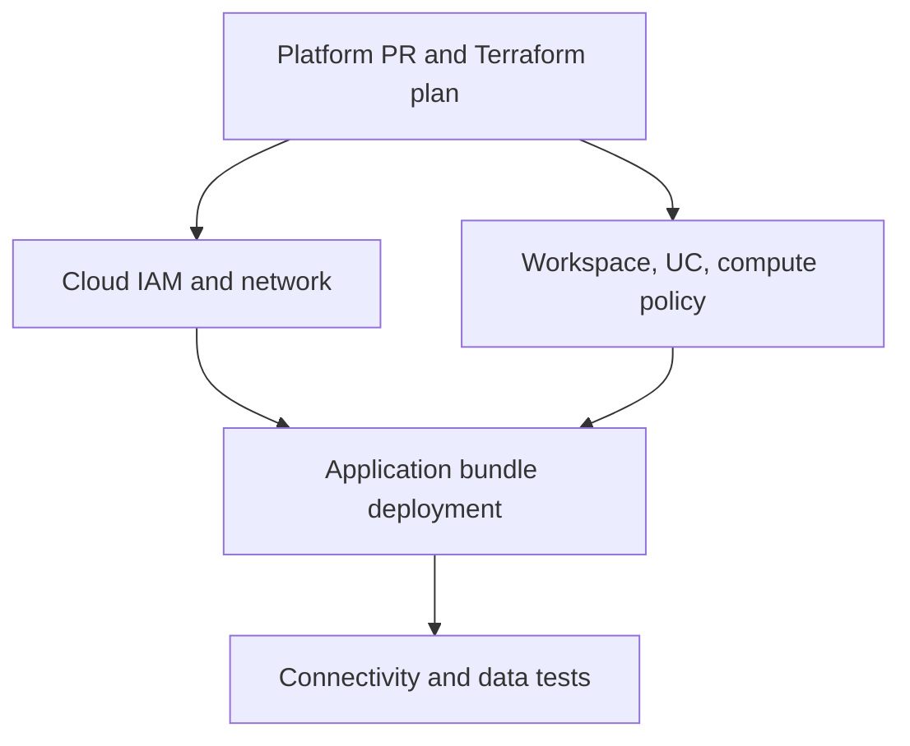

# 23. Terraform, policies, cloud networking, and resource ownership

Automate the platform before deploying the data application.

## Data design and ownership boundaries

| Owner/tool | Objects | Change trigger |
|---|---|---|
| Cloud IaC | ADLS/S3/GCS, IAM, VNet/VPC, private endpoints, routing/DNS | Platform PR |
| Databricks account/workspace IaC | Assignment, policies, UC bootstrap, bindings, warehouses | Platform PR |
| Application bundles | Source assets, jobs, declarative pipelines | Application PR |
| Data migrations | Table schema/protocol/policies, backfills | Reviewed migration release |

Do not let Terraform and a bundle independently manage the same job/pipeline. Even if both tools can create it, competing state ownership causes drift or deletion risk.



## Exact Terraform example and commands

The minimal [uc_bootstrap.tf](../examples/templates/uc_bootstrap.tf) creates a catalog/schema using a preconfigured workspace provider and approved managed location. It does not create a new Databricks workspace or cloud IAM. Pin your reviewed provider version in `.terraform.lock.hcl` after validation.

```sh
terraform init
terraform fmt -check
terraform validate
terraform plan -out=reviewed.plan
terraform show reviewed.plan
# Apply only the reviewed plan through the platform release workflow:
terraform apply reviewed.plan
```

Use an encrypted remote backend with state locking, environment isolation, and controlled access. State can contain sensitive properties. Never put a real client secret in an HCL default or commit plan/state artifacts.

## Buttons and fields for compute policies

As workspace admin use **Compute → Policies → Create policy**, supply a name, approved definition/JSON, and allowed users/groups. A small lab policy can enforce runtime/access mode, worker limits, auto-termination, and cost tags. Copy available workspace/runtime/node-type values, not cloud-independent invented instance names. For job compute reference the policy ID in the bundle; a policy may override otherwise supplied settings.

## Governance and infrastructure automation

Classic compute data-plane networking and serverless network connectivity have different configuration surfaces. Azure private connectivity may involve VNet routing/peering/ExpressRoute and serverless network connectivity configurations; AWS uses VPC endpoints/PrivateLink/routes; GCP uses its documented private connectivity. Test control-plane workspace reachability separately from source data reachability.

UC workspace bindings constrain where a catalog/credential/location can be used; cloud IAM still controls direct storage access. Retain explicit ownership and change records for both.

## Code push automation and maintenance

Review Terraform drift before applying. Reconcile manually created resources through import/migration, not duplicate creation. Promote bootstrap before app deploy; ensure permissions exist before scheduling a first run. Separate production workload identity from platform-admin identity.

## Tests

Automate format/validate and plan policy checks. In a test workspace, prove a forbidden compute setting is rejected, dev cannot use a prod-bound catalog, and required source ports resolve/connect from the actual execution plane. Verify deletion plans do not include managed production data unexpectedly. An IaC syntax check cannot prove cloud IAM or networking works.

## Official references

- [Terraform](https://docs.databricks.com/aws/en/dev-tools/terraform)
- [Configure](https://docs.databricks.com/aws/en/compute/configure)
- [Create Catalog](https://docs.databricks.com/aws/en/catalogs/create-catalog)
- [Manage Privileges](https://docs.databricks.com/aws/en/data-governance/unity-catalog/manage-privileges)

[Guide index](../../DATABRICKS_GUIDE_INDEX.md)
