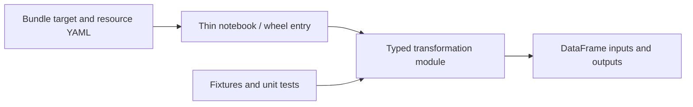

# 24. Git folders, code structure, packages, and runtime upgrades

Make notebook changes reviewable and avoid mutable personal production code.

## Data design and repository structure

Use notebooks for entry-point widgets/orchestration; modules for reusable transforms; SQL/dbt files for SQL models; bundle resources for workflow configuration; fixtures for contract tests. Keep I/O boundaries separate from business transformations. A package's unit tests should not require production secrets.

## Buttons and exact Git fields

Connect your Git provider through the workspace's user settings using the documented integration. **Workspace → your development folder → Create → Git folder**. Fill:

| Field | Value |
|---|---|
| Git repository URL | `https://github.com/sk03167/sql_trick_questions_codex_made.git` |
| Git provider | GitHub |
| Git folder name | `databricks-guide` |
| Sparse checkout | Optional; include `databricks_guide` and needed root files |

Click **Create Git folder**. Open the Git dialog, switch to `databricks-practical-guide`, and confirm the remote branch before editing. Use the Git dialog for branch/create/commit/push/pull operations; review the diff before committing. The guide itself has already been pushed; you do not need to push an unmodified clone.

A developer Git folder can be mutable. Production should run a reviewed bundle deployment or an immutable Git commit/tag configuration, rather than a notebook under a person's editing branch. A source-controlled job's remote checkout and a workspace Git folder are different mechanisms.

## Parameters and dependency maintenance

Make module functions accept explicit `DataFrame`, column mapping, and policy inputs. Keep Spark session/secret lookup/job widgets in the entry point. Pin external dependencies. Use a wheel task when packaging brings clearer versioning; keyword parameters map to entry-point kwargs, positional parameters to your argument parser. Serverless wheel/script tasks need a compatible environment specification; don't paste classic library settings into serverless YAML.

## Governance and infrastructure automation

Limit production source folder edit access and production Git credentials. Run-as principal needs code and table access. Secrets belong in runner/workspace secret systems. Preserve separate dev/prod catalogs even when source code is shared.

## Code push automation and maintenance

Use small PRs with lint/unit tests, local config validation, remote fixture tests, and schema-migration review when relevant. Include runtime/CLI/dependency versions in release metadata. Upgrade DBR/Connect together according to supported compatibility; don't assume local latest PySpark exactly matches the Databricks runtime.

For a schema rename/type change, version the contract, update dependent code/tests/policies, backfill in an isolated target, reconcile, and cut over. A package/code rollback cannot downgrade every Delta protocol feature or recover already overwritten data.

## Tests

Automate transformation edge cases and import/packaging checks. Workspace-test notebook imports, wheel dependencies, run identity, source checkout commit, and secrets. Test a runtime upgrade against skew, timezone/ANSI casting, merge semantics, streaming state, UDFs, and policy enforcement before production.

## Official references

- [Git Operations With Repos](https://docs.databricks.com/aws/en/repos/git-operations-with-repos)
- [Examples](https://docs.databricks.com/aws/en/dev-tools/bundles/examples)
- [Testing](https://docs.databricks.com/aws/en/dev-tools/databricks-connect/python/testing)
- [Ci Cd](https://docs.databricks.com/aws/en/dev-tools/ci-cd)

[Guide index](../../DATABRICKS_GUIDE_INDEX.md)
