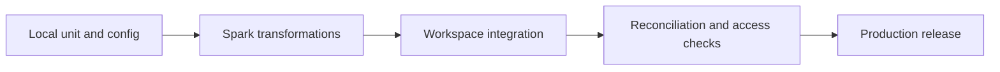

# 25. Tests: local, Spark, workspace, contracts, and production gates

Choose assertions that detect business corruption as well as platform failures.

## Data design and layered tests

| Level | Automate? | Example and failure detected |
|---|---|---|
| Local reference-rule tests | Every PR | Reordering/replay/delete/conflict semantics |
| Static configuration tests | Every PR | YAML schema, code paths, DAG dependencies, missing links |
| Spark DataFrame tests | PR/test cluster | Decimal casts, nulls, dedup, timezone, expected DataFrame |
| Workspace integration | Pre-promotion | UC permissions, Auto Loader checkpoint, Delta MERGE, job parameters |
| Source contract tests | Nightly/on schema changes | API cursor/JSON contract; JDBC schema; Kafka payload |
| Reconciliation | Every production batch | Accepted + quarantined + duplicates; current state/revenue |
| Performance/resilience | Scheduled and release-driven | Lag, skew, source retention, post-commit crash |
| Access/security | Policy releases and periodic | Allowed/denied identity and export paths |
| User acceptance | Metric/model change | Sales definition, delete semantics, date boundaries |



## Commands and exact fixtures

```sh
python3 -m unittest discover -s databricks_guide/examples/tests -v
python3 databricks_guide/tools/validate_guide.py
# After installing tools/requirements.txt:
python3 databricks_guide/tools/validate_config.py
```

The local rule tests are a reference oracle for the Spark implementation. They do not execute a Spark or Delta engine. The checked-in job includes `assert_quality` as a real workspace task to verify its runtime outputs. The fixture contains a retry, update, delete, late pre-delete update, and delete of an unseen key. Expected live state has two orders; revenue uses Decimal arithmetic.

A real Spark test should construct small typed DataFrames, run the production transformation function, compare both schema and unordered rows, and use `assertDataFrameEqual` or equivalent compatible helper. If using Databricks Connect, match its version to supported compute/runtime, authenticate to a test workspace, and use `DatabricksSession`; it is remote compute and can incur cost. Do not install conflicting PySpark/Connect versions into the same environment.

## Buttons and fields

In **Jobs & Pipelines**, make `assert_quality` depend on `publish_gold`; leave its Run if at success for this gate. Assertions must throw on failure. A separate cleanup/notification task can use an appropriate terminal dependency condition; it must not make a failed quality run appear successful. Inspect **Runs → task → Output** for expected/actual rows.

For fixture integration, use an isolated catalog and new landing/state paths. Upload one fixture, run twice unchanged, upload a correction fixture, and run again. Keep the persistent checkpoint for retry/idempotency tests; use a new checkpoint only for an intentionally new replay experiment.

## Governance, infrastructure, and code push automation

PR jobs get no production secret. Integration runner gets a disposable/test catalog and scoped source credentials. Tear down only test-owned resources under an explicit test lifecycle. Save test reports and workspace run URLs with the commit SHA. CI on this guide performs local checks only; deployment templates are opt-in.

## Production gates

Fail publication for conflicting event identity or sequence; alert on unexpected quarantine rates; check freshness against a business clock; reconcile amounts/counts by source boundary. A fixed count threshold is a lab guardrail, not a full production anomaly detector. Define warning/failure severity, owner, and rerun path for each assertion.

## Official references

- [Testing](https://docs.databricks.com/aws/en/dev-tools/databricks-connect/python/testing)
- [Expectations](https://docs.databricks.com/aws/en/ldp/expectations)
- [Jobs Quickstart](https://docs.databricks.com/aws/en/jobs/jobs-quickstart)

[Guide index](../../DATABRICKS_GUIDE_INDEX.md)
