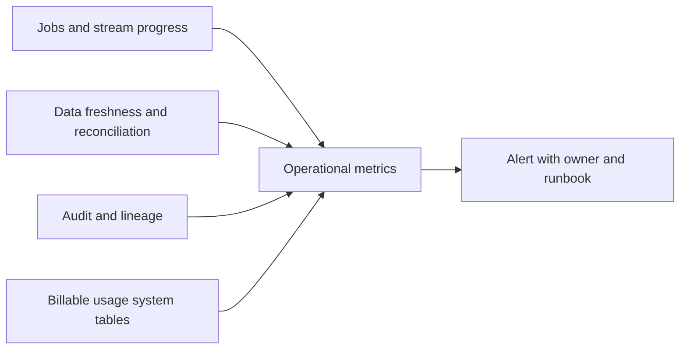

# 26. Monitoring, audit, freshness, and cost

Track correctness and lag alongside run status and compute consumption.

## Data design and exact queries

Store business reconciliation results separately from orchestration success. A run can finish successfully while ingesting zero rows because its subscription, source folder, or parameter is wrong.

```sql
SELECT workspace_id, job_id, run_id,
       MIN(period_start_time) AS first_period,
       MAX(period_end_time) AS last_period,
       SUM(timestampdiff(SECOND, period_start_time, period_end_time)) AS seconds
FROM system.lakeflow.job_run_timeline
WHERE period_start_time >= current_timestamp() - INTERVAL 7 DAYS
GROUP BY workspace_id, job_id, run_id;
```

Timeline records can span multiple slices; aggregate by workspace/job/run rather than treating each slice as a separate run. This query measures recorded run timeline durations, not a billing charge. System tables have documented regional/retention/access boundaries.



## Buttons and fields

**Jobs & Pipelines → job → Runs → Start time** opens a run; click a task for its logs, duration, resolved parameters, and output. For pipeline datasets inspect **Data quality** and update metrics; event logs provide additional details. In job settings configure approved failure/duration notifications. Do not enter arbitrary personal email addresses in a shared template.

Use a SQL query/dashboard to track last successful publication, max source event time, source lag, quarantine count/rate, row deltas, and run duration percentiles. For streaming add state size and batch duration; source lag can be zero while the business timestamp is stale.

## Governance and infrastructure automation

Grant system catalog/schema USE and table SELECT only to approved monitoring principals; regional tables do not expose all regions from one workspace. Audit logs can include sensitive query/context data. Keep monitoring identities separate from workload-write identities. Ensure notifications route to a maintained owner/team endpoint.

## Code push automation and maintenance

Version alert queries and runbooks. Correlate application revision, source boundary, job run ID, table version, and outcome in an ops table. Join billing usage with current documented list-price data only when calculating a clearly labeled estimate; Databricks billable units are not themselves currency and may omit cloud VM/network costs or contract discounts.

Set budgets/tags and measure cost per accepted order or completed batch. Compare serverless versus classic using the same output and latency target. A cheaper run that silently drops late data is not an equivalent alternative.

## Tests

Inject failure, stale input, unexpected zero input, a quarantine spike, and source lag. Verify alerts fire once as intended and contain a useful run URL. Test permissions to system tables and regional dashboards. Record observed latency/cost with workload size; do not publish unsupported throughput or cost guarantees.

## Official references

- [Jobs](https://docs.databricks.com/aws/en/admin/system-tables/jobs)
- [Billing](https://docs.databricks.com/aws/en/admin/system-tables/billing)
- [Jobs](https://docs.databricks.com/aws/en/jobs)
- [Expectations](https://docs.databricks.com/aws/en/ldp/expectations)

[Guide index](../../DATABRICKS_GUIDE_INDEX.md)
