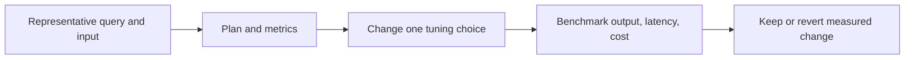

# 27. Performance, liquid clustering, file sizes, and table maintenance

Tune after proving correctness and use measurements tied to a workload.

## Data design and exact commands

Start with query plan and data distribution. Avoid turning on every tuning feature simultaneously. Small-file ingestion, high-cardinality joins, skewed keys, repeated scans, and unnecessary Python UDFs have different remedies.

```sql
DESCRIBE DETAIL de_lab_dev.silver.orders_state;
DESCRIBE HISTORY de_lab_dev.silver.orders_state;
EXPLAIN FORMATTED
SELECT * FROM de_lab_dev.silver.orders_current WHERE order_id = 'O100';
```

For a compatible Delta table/runtime, liquid clustering is an alternative to partitioning/ZORDER:

```sql
ALTER TABLE de_lab_dev.silver.orders_state CLUSTER BY (order_id);
OPTIMIZE de_lab_dev.silver.orders_state;
```

Choose clustering keys from common selective filters and join patterns, not every column. Automatic liquid clustering and predictive optimization have additional managed-table/runtime/enablement requirements. Do not combine partitioning, ZORDER, and liquid clustering as though they were cumulative independent flags. A tiny fixture cannot measure their benefit.



## Parameters and decisions

| Problem | Candidate change | Measure |
|---|---|---|
| Source overload | Fewer JDBC partitions/larger paced batches | Source CPU/connections and latency |
| Tiny files | Upstream compaction or optimized write/maintenance | File count/size and task overhead |
| Hot join key | Better key design, salting with correct semantics, adaptive execution | Spill/skew and row correctness |
| Repeated full scan | Incremental CDC with retained ordering state | Scan bytes and replay invariants |
| Selective queries | Suitable clustering/data-skipping statistics | Read bytes and query duration |
| Idle compute | Serverless/job compute/auto-stop | Full cost plus start-up latency |

## Buttons, governance, and infrastructure automation

Inspect SQL warehouse query history/profile and Spark task/stage metrics in supported compute UI. Compare concurrent representative workload, not a single cached rerun. Only workload/table owners manage maintenance; readers need no write privileges.

`VACUUM` deletes eligible unreferenced files. Keep retention longer than maximum consumer lag, recovery requirement, and audit/time-travel requirement. Never disable the retention safety check as a generic tuning step. The default file retention is commonly seven days, but inspect actual table properties and platform automation before relying on it.

## Code push automation and maintenance

Version maintenance policy with ownership, frequency, retention, and test evidence. Table feature/protocol upgrades can affect older/external clients. Revalidate connectors and downgrade/rollback options before enabling them. Do not schedule manual maintenance that competes with platform-managed optimization without reason.

## Tests

Require equal output before/after tuning, record cold and warm behavior, p95 latency, source load, file/scan metrics, and cost. Test a lagging stream across the retention boundary in a disposable table. Verify recovery/backfill can still read the required versions after the maintenance policy is applied.

## Official references

- [Clustering](https://docs.databricks.com/aws/en/tables/clustering)
- [Delta Vacuum](https://docs.databricks.com/aws/en/sql/language-manual/delta-vacuum)
- [Delta Lake](https://docs.databricks.com/aws/en/structured-streaming/delta-lake)
- [Merge](https://docs.databricks.com/aws/en/delta/merge)

[Guide index](../../DATABRICKS_GUIDE_INDEX.md)
