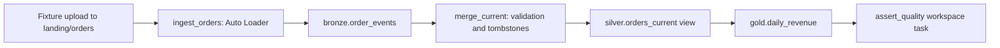

# 28. Worked orders lab: from fixture upload to published revenue

Run the connected examples, verify exact outputs, and exercise a late-delete retry.

## Data design and prerequisites

Complete catalog/schema/volume setup from chapter 04. The executable reference assumes UC-enabled serverless notebook Jobs; a classic-compute resource template is provided separately. Run-as must have namespace, volume, source-code, and table/view creation/write permissions. Development deployment uses your authenticated identity unless configured otherwise.



## Buttons and steps

1. **Catalog → de_lab_dev → ops → landing → Upload to this volume**: create/select `orders` and upload `orders_001.json`. Or use the CLI below after creating the folder.
2. Configure the workspace host and deploy the bundle in chapter 20. That creates four notebook tasks with the reviewed dependencies.
3. **Jobs & Pipelines → deployed orders job → Edit parameters**: verify catalog `de_lab_dev`, run_date `2026-10-12`, min_current_rows `2`, validate_fixture `true`.
4. **Run now**. Inspect all four task outputs. Verify the fixture assertions succeed.
5. Run again unchanged, using the same checkpoint. Counts and business results must remain stable.
6. Upload `orders_002.json` under a new file name. Run with `validate_fixture=false` and `min_current_rows=1`, then verify correction expectations below.

```sh
cd databricks_guide/examples
# After creating landing/orders via Catalog or dbutils.fs.mkdirs:
databricks fs cp fixtures/orders_001.json \
  'dbfs:/Volumes/de_lab_dev/ops/landing/orders/orders_001.json' --profile de-lab
export BUNDLE_VAR_workspace_host='https://<dev-workspace-host>'
databricks bundle validate -t dev --profile de-lab
databricks bundle deploy -t dev --profile de-lab
databricks bundle run orders_daily -t dev --profile de-lab \
  --params 'catalog=de_lab_dev,run_date=2026-10-12,min_current_rows=2,validate_fixture=true'
```

The CLI's `dbfs:/Volumes` URI addresses a UC volume; it is not a recommendation to store data in legacy DBFS root. Do not overwrite already delivered fixture files.

## Exact expected output

First file: O100 current amount `120.00`, sequence 2, region IN; O300 amount `50.00`, sequence 1, region US. O200 is a sequence-3 tombstone despite a subsequently arriving sequence-2 update; O999 is an unmatched-delete tombstone. Current row count 2; revenue IN `120.00`, US `50.00`, order date `2026-10-12`. A repeated event is preserved in bronze but has no additional current-state effect.

Second file: O100 sequence 3 correction to `130.00`; O300 sequence 2 delete. Current row count 1; IN revenue `130.00`; no US group. Replaying either file must not change these results.

## Governance and infrastructure automation

Use a disposable catalog for integration. Consumers query only gold/current views. State/tombstone tables retain ordering evidence; expose no arbitrary raw storage path to readers. The lab is small and scans complete bronze at merge time, chosen for understandability; production needs incremental processing/monitoring and schema migrations.

## Code push automation and maintenance

Source version, job run/date parameters, bronze table version, checkpoint identity, and final results form release evidence. Deploying a new revision does not reset the checkpoint. Before moving to prod supply approved host/run-as/IAM/catalog bindings and run the access/retention tests. The author did not run these examples against a live Databricks workspace.

## Tests

Local fixture-oracle tests run without Spark. The job's final task tests the real engine outputs and asserts fixture row/revenue values when validate_fixture is true. Retry, correction, late update, conflict, quarantine, identity, and throughput tests are described in chapter 25; complete them before claiming production readiness.

## Official references

- [Jobs Quickstart](https://docs.databricks.com/aws/en/jobs/jobs-quickstart)
- [Production](https://docs.databricks.com/aws/en/ingestion/cloud-object-storage/auto-loader/production)
- [Merge](https://docs.databricks.com/aws/en/delta/merge)
- [Examples](https://docs.databricks.com/aws/en/dev-tools/bundles/examples)

[Guide index](../../DATABRICKS_GUIDE_INDEX.md)
