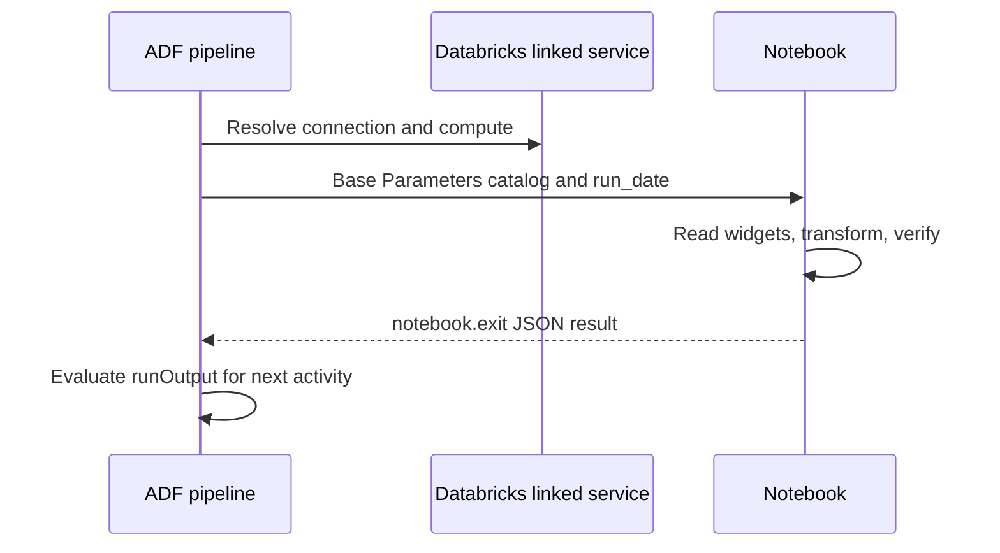

# 29. ADF integration: linked service, Base Parameters, and return values

Pass ADF variables to Databricks without confusing its expression language with job syntax.

## Data design and buttons

Use ADF for source movement/external dependencies, then run a Databricks notebook for transformations. ADF's Notebook activity is not a continuous Kafka consumer. Avoid giving ADF and the Databricks job independent schedules for the same workflow.



In ADF Studio, **Manage → Linked services → New → Azure Databricks**. Name `ls_databricks_dev`, select the approved workspace and supported authentication method (managed identity/service principal per your linked-service version), choose the supported compute configuration, test connection, and Create. UC data permissions apply to the resulting execution identity; passing the connection test is not proof of table access.

In **Author → pipeline**, add string parameters `catalog` default `de_lab_dev` and `run_date` default `2026-10-12`. Search **Notebook** in Activities, drag it onto the canvas, Name `RunOrders`. On **Azure Databricks** select the linked service. On **Settings**, set **Notebook path** to the actual deployed workspace path and add **Base Parameters**:

| Key | Value via Add dynamic content |
|---|---|
| `catalog` | `@pipeline().parameters.catalog` |
| `run_date` | `@pipeline().parameters.run_date` |
| `orchestrator_run_id` | `@pipeline().RunId` |

Notebook source must read exactly those widget names. ADF `@...`, Jobs `{{...}}`, and bundle `${...}` are different evaluation systems. **Validate → Debug** for a development run; **Publish all** publishes the approved pipeline definitions. Confirm the notebook path includes the leading slash and belongs to the intended workspace.

## Returning a value

At successful completion of a custom ADF wrapper notebook:

```python
import json
dbutils.notebook.exit(json.dumps({"status": "ok", "published_rows": 2}))
```

Use a downstream ADF expression such as `@json(activity('RunOrders').output.runOutput).published_rows` when runOutput is a JSON string. Inspect your activity output's actual type before applying an extra `json()` parse. `dbutils.notebook.exit` is a notebook return value, not a Lakeflow Jobs task value. The ADF return-size contract is bounded; store detailed results in an ops table.

## Governance and infrastructure automation

Provision the ADF integration runtime/source connectivity, Databricks linked service, and execution principal separately. Self-hosted IR can move on-prem data, but does not automatically give a Databricks cluster private access to the same on-prem database. Configure each required execution plane.

## Code push automation and maintenance

Version ADF pipelines and Databricks code together through coordinated releases. Consider calling an already deployed multi-task Job via supported activity/API integration instead of embedding a mutable notebook dependency chain. Preserve correlation IDs and request idempotency, and distinguish activity success from business publication.

## Tests

Verify parameter defaults/overrides and displayed resolved inputs in ADF/Databricks. Fail the notebook and prove ADF marks the activity failed; test timeout, absent output key, JSON parsing, identity privileges, and source retries. Re-run the ADF activity after a target commit and require stable business output.

## Official references

- [ADF Notebook activity](https://learn.microsoft.com/en-in/azure/data-factory/transform-data-databricks-notebook)
- [ADF transformation template](https://learn.microsoft.com/en-us/azure/data-factory/solution-template-databricks-notebook)
- [Databricks Utils](https://docs.databricks.com/aws/en/dev-tools/databricks-utils)

[Guide index](../../DATABRICKS_GUIDE_INDEX.md)
