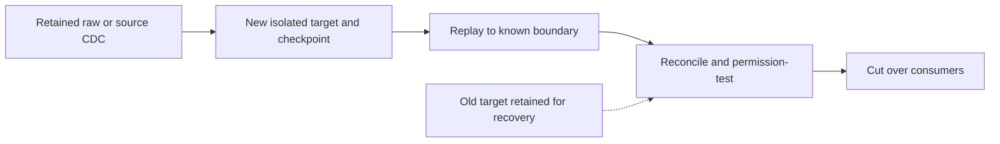

# 30. Cloud substitutions, federation, sharing, and recovery

Change one technology deliberately, and know which state you must restore.

## Data design and cloud substitution matrix

| Concern | Azure | AWS | GCP | What is reusable |
|---|---|---|---|---|
| Object storage | ADLS Gen2 `abfss://` | S3 `s3://` | GCS `gs://` | UC volume path and table APIs |
| Storage credential | Access Connector managed identity | IAM role with required trust | Databricks-generated GCP service account | Credential/location/volume hierarchy |
| Kafka-compatible source | Event Hubs | MSK/Confluent Kafka | Managed Kafka/Confluent Kafka | Kafka format and offset/checkpoint logic |
| Private on-prem path | ExpressRoute/VNet routes | Direct Connect/VPC routes | Approved GCP private routes | Source contract and reconciliation |
| Platform IaC | AzureRM + Databricks provider | AWS + Databricks provider | Google + Databricks provider | Separation of state/resource ownership |
| CI | GitHub/Azure DevOps/Jenkins/GitLab | Same CI choices | Same CI choices | Bundle targets; identity adapters differ |

Pub/Sub, Kinesis, and Kafka are distinct protocols; don't replace only a hostname in Kafka code for a non-Kafka service. Use its supported connector or land events to cloud storage and ingest files. Availability of serverless, managed connectors, federation, credentials, and networking differs by region/account/cloud.

## Buttons and fields: AWS/GCP storage

AWS credential setup requires the Databricks-documented IAM trust/external-ID process, including current self-assume requirements; use **Catalog → Create a credential**, select the AWS role route, and enter the approved role ARN. For an external location use name, S3 URL, and selected credential, then validate. Do not copy an Azure Access Connector ID into an AWS credential.

GCP: **Catalog → Create a credential → GCP Service Account**, name `gcs_lab_cred`, Create, copy the generated service-account email. In GCS bucket **Permissions → Grant access**, grant the documented bucket/object roles to that principal. Then **Catalog → Create an external location**, Storage type GCP, URL `gs://<bucket>/landing`, credential `gcs_lab_cred`, Create/validate. Current docs do not support GCS hierarchical-namespace buckets for this external-location route; Azure's HNS requirement cannot be carried across.

## Federation versus ingestion and sharing

Query federation creates a UC connection and foreign catalog and queries supported external databases without first materializing all data. It depends on source availability/load/network; it does not capture a historical CDC feed. Use it for migration discovery, light remote queries, or appropriate federated joins; materialize when source load/SLA/recovery require it.

The current sharing docs call direct data sharing OpenSharing (many existing materials say Delta Sharing). Use the supported sharing workflow and approved shares/recipients rather than handing out raw bucket keys. Sharing is different from a regionally independent writable DR replica. Test recipient capabilities and policy constraints.

## Governance and infrastructure automation

Back up source code/configuration, UC metadata/grants, secrets/identity recovery procedures, raw inputs, table data/logs, and checkpoints where supported. Cloud object replication alone does not recreate UC objects/jobs/policies, and copying a live checkpoint to another workspace is not a universal failover procedure.

## Code push automation and maintenance

For backfill use a separate target/state namespace or a carefully bounded idempotent merge; reusing the production checkpoint with changed source/query is not a safe replay plan. For CDF distinguish current automatic CDF (DBR 19+ and qualifying row tracking/format) from legacy configured CDF; both have retention limits. Set a new checkpoint and an available starting version only when you know the destination's last committed boundary. Archive changes permanently if required.

## Tests

Prove restore to a specified RPO/RTO with a captured source boundary, replay including deletes, permissions and masking, identity recreation, and consumer cutover. Test source logs expiring, VACUUM removing needed history, lost checkpoint, a failed region, and an incompatible schema/code rollback. Record measured recovery time and lost-data interval; backups that have never been restored are unverified.

## Official references

- [Query Federation](https://docs.databricks.com/aws/en/query-federation)
- [Data Sharing](https://docs.databricks.com/aws/en/data-sharing)
- [Change Data Feed](https://docs.databricks.com/aws/en/tables/features/change-data-feed)
- [Cloud Storage](https://docs.databricks.com/aws/en/connect/unity-catalog/cloud-storage)
- [External Locations Gcs](https://docs.databricks.com/gcp/en/connect/unity-catalog/cloud-storage/external-locations-gcs)

[Guide index](../../DATABRICKS_GUIDE_INDEX.md)
