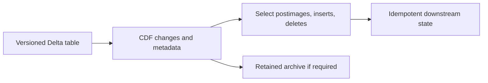

# 31. Delta change data feed and version-bound recovery

Read inserts, updates, and deletes downstream without treating CDF as a permanent audit log.

## Data design and exact parameters

A database CDC feed describes changes in the source database. Delta CDF describes changes in a Delta table; it does not make JDBC capture source hard deletes. Preserve both concepts separately.

Current automatic CDF requires qualifying UC tables and DBR 19+ with row tracking/appropriate format. The legacy explicit Delta CDF route remains a useful compatibility example. Do not enable both approaches together. For a legacy lab table before making changes:

```sql
ALTER TABLE de_lab_dev.silver.orders_state
SET TBLPROPERTIES ('delta.enableChangeDataFeed' = 'true');
```

Record the table version when enabling it. Legacy CDF cannot return earlier unrecorded changes. For an example interval, replace 10/12 with actual retained versions:

```sql
SELECT order_id, sequence, op, _change_type, _commit_version
FROM table_changes('de_lab_dev.silver.orders_state', 10, 12);
```

Start/end version bounds are inclusive. An incremental batch reader advances from last committed version + 1 only after the sink commit. Structured Streaming tracks consumed versions through its checkpoint:

```python
changes = (spark.readStream.option("readChangeFeed", "true")
           .option("startingVersion", 10)
           .table("de_lab_dev.silver.orders_state"))
# Write to an idempotent destination with a separate stable checkpoint.
```



`update_preimage` is before the change; `update_postimage` is after. A current-state consumer normally applies postimages/inserts and deletes, not both update images as new facts. The lab's business delete is a tombstone UPDATE to orders_state, so downstream interpretation must also inspect `is_deleted`/`op`. A physical Delta DELETE has a different CDF change type.

## Buttons and fields

Use **Catalog → table → History** where available or `DESCRIBE HISTORY` to capture versions. In a new downstream job, Parameters `source_table`, `starting_version`, `target_catalog`; validate table allowlist and integer version. Assign a new, distinct checkpoint for the new downstream stream. Run detail should record the source boundary and target commit.

## Governance and infrastructure automation

CDF access requires source table SELECT and namespace USE; archive write requires target grants. CDF can contain removed sensitive values, so apply its access and retention policy deliberately. A governed table view/filter does not automatically define the same allowed CDC export contract for every client.

## Code push automation and maintenance

Retained table/log/CDF history must exceed downstream lag. If required starting version is gone, reinitialize from a controlled snapshot and reconcile; changing the parameter to latest silently loses changes. A code rollback cannot restore vacuumed data. Schema changes and column mapping have CDF compatibility constraints; test the actual release.

## Tests

Use a disposable source: insert, update, physical delete, business tombstone, and two writes in one version interval. Assert no duplicate postimage effect on retry. Restart at a known boundary; test an expired version failing visibly. Verify permanent audit requirements use a separate retained archive rather than transient table history.

## Official references

- [Change Data Feed](https://docs.databricks.com/aws/en/tables/features/change-data-feed)
- [Delta Lake](https://docs.databricks.com/aws/en/structured-streaming/delta-lake)
- [Foreach](https://docs.databricks.com/aws/en/structured-streaming/foreach)

[Guide index](../../DATABRICKS_GUIDE_INDEX.md)
