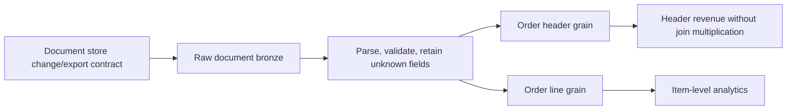

# 32. NoSQL, nested JSON, schema drift, and grain changes

Ingest document changes and transform nested records without multiplying amounts accidentally.

## Data design and source contract

For Cosmos DB/MongoDB/document APIs choose a supported managed/native connector only after checking its cloud/runtime package and change/delete semantics. The portable baseline is a controlled export/change stream to immutable JSON files, then Auto Loader. It is not a claim that every document store supplies deletes in every feed mode.

Store document ID, source partition/key, source version/sequence, operation, raw payload, event timestamp, and delivery metadata. Different change-feed modes can expose different retention and delete behavior. Define full-document versus partial-patch semantics before applying updates.



## Exact transformation example

For documents with `order_id`, header `amount`, and array `items`, keep header and line tables distinct:

```python
from pyspark.sql import functions as F
headers = documents.select("order_id", "amount", "region")
lines = (documents.select("order_id", F.posexplode_outer("items").alias("line_index", "item"))
         .select("order_id", "line_index", "item.sku", "item.quantity", "item.unit_price"))
```

Use a source-provided stable line ID instead of array position when items can reorder. `posexplode_outer` preserves a null row for an empty/null array; decide whether to retain that row as evidence or filter it from the line-fact table. A header amount of 100 joined to three lines must not become 300 of revenue. Aggregate header-grain revenue from headers, or deliberately allocate it with a reconciled rule.

## Buttons and parameters

Use chapter 09's notebook/job route with `cloudFiles.format=json`, a distinct source folder `.../landing/documents`, schema location `.../state/document_schema_v1`, checkpoint `.../state/document_bronze_v1`, and target `bronze.documents`. **Job task → Parameters** exposes the chosen catalog and non-sensitive paths; secrets remain separate. Use a separate declared nested schema for the document contract, not the flat orders fixture schema.

For flexible semi-structured storage consider supported VARIANT functions and feature constraints; retaining flexible data does not remove the need to enforce types/grain in curated tables. Keep unknown fields/quarantined documents inspectable.

## Governance, infrastructure, and CI/CD

A raw document can contain PII even if gold is an aggregate. Restrict bronze and document exports, use source-scoped credentials, and test source partition/change-feed throughput. Pin connector packages and schema contracts. Promote schema changes with recorded fixtures of old/new documents.

## Tests

Automate null/empty arrays, missing fields, wrong types, extra fields, line reorder, duplicate document versions, partial patch, source delete, and multi-line join multiplication. Assert header totals reconcile before/after flattening. Test replay/backfill beyond source change retention and explain whether resnapshot detects missing documents.

## Official references

- [Schema](https://docs.databricks.com/aws/en/ingestion/cloud-object-storage/auto-loader/schema)
- [Api Options](https://docs.databricks.com/aws/en/spark/api-options)
- [Spark complex-type functions](https://spark.apache.org/docs/latest/api/python/reference/pyspark.sql/functions.html)

[Guide index](../../DATABRICKS_GUIDE_INDEX.md)
