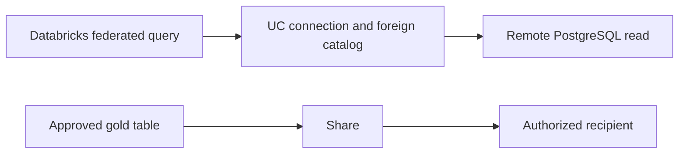

# 33. Federation connections, foreign catalogs, and governed sharing

Read remote PostgreSQL without ingestion, and distribute approved tables to recipients.

## Data design and buttons: query federation

Choose federation for supported remote reads when source load/availability is acceptable. A foreign catalog mirrors metadata; it is not an ingestion archive or a write destination.

**Catalog → Add icon → Create a connection**. Connection name `pg_orders_read`, Connection type PostgreSQL, Next. Fill Host `db.de.example`, Port `5432`, User the approved read-only database identity, Password in the protected wizard field, and the TLS certificate option if required. Complete the wizard using the actual source database/network contract.

Create a foreign catalog using **Create catalog → Foreign catalog**: Catalog name `pg_orders_foreign`, Connection `pg_orders_read`, Database `sales`. Or:

```sql
CREATE FOREIGN CATALOG pg_orders_foreign
USING CONNECTION pg_orders_read
OPTIONS (database 'sales');
SELECT * FROM pg_orders_foreign.public.orders LIMIT 10;
```

Compute/warehouse must meet federation requirements and reach the database. Grant remote-read identity privileges in PostgreSQL and UC access to allowed foreign objects. Do not put password literals in checked-in CREATE CONNECTION SQL.



## Exact sharing contract

Current docs use OpenSharing, with many older references using Delta Sharing. A share contains approved assets, not a blanket cloud credential. For a simple provider SQL example after account setup:

```sql
CREATE SHARE de_lab_gold_share;
ALTER SHARE de_lab_gold_share ADD TABLE de_lab_dev.gold.daily_revenue;
-- An administrator creates the intended recipient using the documented
-- Databricks-to-Databricks or open-recipient authentication workflow.
GRANT SELECT ON SHARE de_lab_gold_share TO RECIPIENT approved_partner;
```

Use **Catalog**'s sharing/provider workflow for your account, choose the share and Add assets, then explicitly select the recipient. Follow the linked create-share/recipient pages for your sharing mode's UI. Do not use an open-recipient bearer token as a notebook parameter or publish it in Git. Recipient mode, shared asset type, CDF/history support, and policy constraints differ.

## Governance and infrastructure automation

Creator needs the documented metastore/share/table privileges; consumers get only the approved assets. Authorize disclosure of aggregates and fine-grained data explicitly. A recipient's ability to cache received data affects deletion/retention governance. UC policies in the provider are not a promise that a recipient can run every identical function/client feature.

## Code push automation and maintenance

Version connection/foreign-catalog/recipient/share metadata and ownership through the platform deployment owner. Promote asset definitions only after their schema/consumer tests pass. Sharing between accounts/regions can incur network costs; it is not a substitute for DR backups or a writable secondary table.

## Tests

Federation: source downtime, denied source login, projection/filter pushdown, type mapping, concurrent source load, and query cancellation. Sharing: allowed recipient, revoked recipient, unshared table denial, schema change, history/CDF compatibility, and expected masking/filtering for each recipient mode. Capture actual consumer-client results.

## Official references

- [Postgresql](https://docs.databricks.com/aws/en/query-federation/postgresql)
- [Create Catalog](https://docs.databricks.com/aws/en/catalogs/create-catalog)
- [Create Share](https://docs.databricks.com/aws/en/opensharing/create-share)
- [Data Sharing](https://docs.databricks.com/aws/en/data-sharing)

[Guide index](../../DATABRICKS_GUIDE_INDEX.md)
