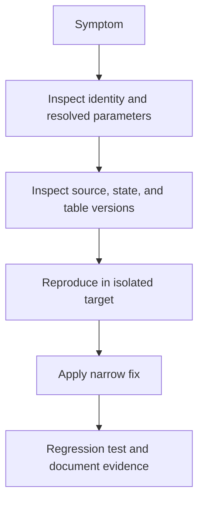

# 34. Troubleshooting by symptom, field, and evidence

Use a concrete diagnostic order before changing permissions or resetting state.

## Data design and diagnostic map

| Symptom | First evidence | Check/change | Regression test |
|---|---|---|---|
| Widget missing | Task run Parameters and notebook key | Exact key spelling; notebook task type | Override reaches widget |
| Literal braces in input | Resolved parameter displayed | Put dynamic reference in task field; valid namespace | Known reference resolves |
| Wrong environment table | Bundle target, job catalog, Run as | Separate target/host/catalog and allowlist | Prod cannot be chosen by dev identity |
| Zero Kafka rows | Topic/offset/checkpoint/retention | New query starts latest by default; inspect retained offsets | Produce fresh event and verify offset |
| Auto Loader duplicates after fix | Checkpoint lineage/source file identity | Stop run-ID checkpoint paths; controlled replay | Rerun unchanged source |
| New field fails stream | Schema metadata/rescued data | Explicit rescue or reviewed evolution/restart | Old and new field fixture |
| MERGE duplicate-match error | Source rows per target key | Dedup by source ordering; reject conflicts | Multiple changes same key |
| Deleted row returns | State/tombstone sequence | Preserve highest delete ordering | Late pre-delete update |
| UC access denied | Run-as identity + SHOW GRANTS | Namespace USE and object privileges | Allowed/denied principal |
| Storage timeout | DNS/route/endpoint from compute | Correct execution-plane networking | Read a tiny source file |
| CDF version unavailable | Source history and retention | Controlled snapshot initialization | Expired-version failure is visible |
| CI auth denied | Auth type, client UUID, federation subject | Match environment policy and assignment | Wrong subject rejected |
| Deployment creates extra job | Bundle name/target/root state | Restore stable deployment identity/path | Subsequent deploy updates same ID |
| SQL totals too large | Join grain/cardinality | Preaggregate or separate header/line totals | Multi-line order invariant |

## Buttons and exact evidence to retain

**Jobs & Pipelines → job → Runs → Start time → failing task**: record Result state, exception class/message, Parameters, Run as, source revision, and relevant logs. For pipeline use its update detail, dataset graph, quality metrics, and event log. For SQL use warehouse query history/profile. In Catalog inspect object name, owner, grants, lineage, and table history.

The minimal incident record contains workspace ID, job/pipeline/run/update ID, catalog/table, source boundary, checkpoint path, source revision, runtime/CLI version, and safe error text. Exclude tokens/passwords and raw PII. “It works in my notebook” is insufficient if that notebook runs as a different identity or has different defaults.

## Governance and infrastructure automation

Check the exact deny layer: runner→workspace auth; run-as→compute/source-code rights; UC namespace/object privileges; cloud IAM; source-system ACL; network route. Grant only the missing permission with the approved owner. A connectivity error is not resolved by granting more UC rights.

## Code push automation and maintenance

Reproduce with the smallest relevant fixture. Version the fix, run the targeted regression and required integration gates, deploy to dev/test, then promote the same revision. Document any state/schema migration separately from code. Do not remove checkpoints, force-load files, truncate tables, or disable data-loss checks as generic troubleshooting.

## Tests

Each row above becomes a failure-injection scenario in a disposable environment. A recovery test must assert output correctness and continued retention/permissions, not merely a run switching to success. After incident resolution add a narrow regression test for the actual failure, avoiding tests that simply mirror configuration text.

## Official references

- [Configure Task](https://docs.databricks.com/aws/en/jobs/configure-task)
- [Dynamic Value References](https://docs.databricks.com/aws/en/jobs/dynamic-value-references)
- [Schema](https://docs.databricks.com/aws/en/ingestion/cloud-object-storage/auto-loader/schema)
- [Change Data Feed](https://docs.databricks.com/aws/en/tables/features/change-data-feed)

[Guide index](../../DATABRICKS_GUIDE_INDEX.md)
