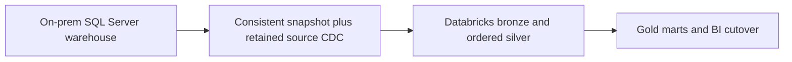
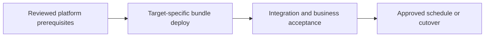

# On-prem warehouse migration with parallel reconciliation

Replace a legacy warehouse while controlling write cutover, reconciliation, and recovery.

## Data design

## Exact input/field checklist

| Input or setting | Fill with |
|---|---|
| `source_boundary` | DBA-approved snapshot/log boundary |
| `catalog` | de_lab_dev then de_lab_prod |
| `history_mode` | Current state or approved SCD2 |
| `cutover_window` | Measured and agreed; no invented zero downtime |

## Walkthrough and buttons

1. Inventory source objects, job dependencies, SQL dialect behavior, consumers, security, and SLA. Decide which objects to rebuild and which to migrate unchanged.
2. Build ADLS storage/UC access through chapters 03–04; configure approved on-prem network connectivity from the actual extraction plane.
3. Use chapter 10 for a consistent snapshot and chapter 11 for managed changes; hold a source boundary that bridges snapshot and changes without a gap.
4. Create Databricks marts and run both old and new outputs for captured boundaries; reconcile counts, decimal totals, nulls, timezone, deletes, and dimension history.
5. Drain changes, prove the final reconciliation, then switch consumers. A brief write freeze may be needed if no safe boundary/dual-run contract exists; low downtime depends on the source and cutover design.
6. Retain the old system/read path for the agreed rollback period and document how post-cutover writes are handled if rolling back.

The linked recipes contain the exact button sequences, code, and prerequisites: [03. Azure storage identity and external locations](../chapters/03-azure-storage-identity.md); [04. Catalogs, schemas, volumes, and minimum grants](../chapters/04-catalogs-volumes-grants.md); [10. Database snapshots, JDBC, and incremental extraction](../chapters/10-jdbc-and-incremental.md); [11. Lakeflow Connect: managed SQL Server CDC](../chapters/11-managed-cdc.md); [15. Ordered CDC, MERGE, hard deletes, and SCD history](../chapters/15-cdc-scd-merge.md); [17. Gold tables, SQL warehouses, dbt, and exports](../chapters/17-gold-and-sql-serving.md); [30. Cloud substitutions, federation, sharing, and recovery](../chapters/30-clouds-and-recovery.md).

## Governance and infrastructure automation

Platform Terraform provisions private networking/storage/UC. Jobs or Connect definitions are application-owned. Production execution uses a principal with the specific source and target grants.

## Code push automation and maintenance

GitHub Actions, Azure DevOps, or Jenkins can deploy the same bundle; none replaces the DBA source configuration or business reconciliation. Use a coordinated migration release instead of an automatic consumer cutover on every push.

## Tests to automate and tests to rehearse

Automate snapshot+CDC completeness, deletes, decimal totals, and job retry. Rehearse source freeze/cutover/rollback and measure RPO/RTO.

## Technology substitutions

Use the same business contract and acceptance fixture when replacing one component. Files can use COPY INTO for smaller bounded deliveries or Auto Loader for incremental scale; custom Jobs transforms can be replaced by Lakeflow declarative tables if their state/ownership semantics fit. Custom extraction can be replaced by managed Connect only for supported connectors/contracts. Azure/AWS/GCP and CI-vendor replacements require the identity/network/feature changes in chapters 22 and 30; they are not a promise that every Cartesian combination is valid.

## Completion evidence

Save source boundary, reviewed code SHA, resolved parameters, run URL, table versions, reconciliation/access results, and measured freshness/recovery/cost. This recipe is a design/lab guide; it was not executed in a customer workspace.

[Guide index](../../DATABRICKS_GUIDE_INDEX.md)
