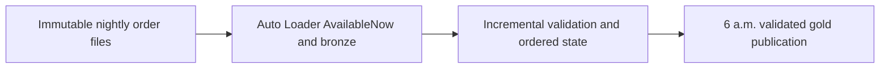

# Daily files: 100 million orders ready by 6 a.m.

Design a bounded ingest-and-transform workload against a deadline and a measurable capacity model.

## Data design

## Exact input/field checklist

| Input or setting | Fill with |
|---|---|
| `catalog` | de_lab_prod |
| `source_path` | Approved landing volume/orders |
| `checkpoint_path` | Stable orders stream lineage |
| `job_deadline` | 06:00 business timezone |
| `rate_limit` | Measured maxFilesPerTrigger/maxBytesPerTrigger |

## Walkthrough and buttons

1. Choose business date, expected file completion manifest, late-file policy, and timezone before choosing a cron expression.
2. Use chapter 09 Auto Loader and a persistent checkpoint. Use a file-arrival trigger or source completion event only when its storage/file-events prerequisites are configured.
3. Configure chapter 07 job dependencies, concurrency 1 for shared state, timeout/retries, and failure/duration notifications. Add quality/reconciliation before publication.
4. Benchmark realistic bytes, file counts, duplicate distribution, and skew. 100 million rows alone does not determine compute size: row width and transformations matter.
5. Derive throughput from the usable processing window after arrival, start-up, transformation, verification, and retry reserve. Tune chapter 27 using measured scan/shuffle metrics.
6. Publish a freshness marker only after validation, so consumers can distinguish a completed day from partial files.

The linked recipes contain the exact button sequences, code, and prerequisites: [07. Lakeflow Jobs, dependencies, task values, and loops](../chapters/07-jobs-task-values.md); [09. Auto Loader: schema, checkpoints, triggers, and replay](../chapters/09-auto-loader.md); [15. Ordered CDC, MERGE, hard deletes, and SCD history](../chapters/15-cdc-scd-merge.md); [25. Tests: local, Spark, workspace, contracts, and production gates](../chapters/25-test-strategy.md); [26. Monitoring, audit, freshness, and cost](../chapters/26-observability-cost.md); [27. Performance, liquid clustering, file sizes, and table maintenance](../chapters/27-performance-delta.md).

## Governance and infrastructure automation

Restrict landing/state writes and separate consumer access to gold. IaC configures storage notifications/network/policy; test the actual job Run as principal.

## Code push automation and maintenance

Use bundles plus any supported CI vendor. The data-ready trigger is operational scheduling, while code push deploys configuration; do not make every code push reprocess production blindly.

## Tests to automate and tests to rehearse

Automate rerun invariance, partial/late delivery, empty batch, quarantine spike, performance deadline with retry reserve, and a missed-arrival alert.

## Technology substitutions

Use the same business contract and acceptance fixture when replacing one component. Files can use COPY INTO for smaller bounded deliveries or Auto Loader for incremental scale; custom Jobs transforms can be replaced by Lakeflow declarative tables if their state/ownership semantics fit. Custom extraction can be replaced by managed Connect only for supported connectors/contracts. Azure/AWS/GCP and CI-vendor replacements require the identity/network/feature changes in chapters 22 and 30; they are not a promise that every Cartesian combination is valid.

## Completion evidence

Save source boundary, reviewed code SHA, resolved parameters, run URL, table versions, reconciliation/access results, and measured freshness/recovery/cost. This recipe is a design/lab guide; it was not executed in a customer workspace.

[Guide index](../../DATABRICKS_GUIDE_INDEX.md)
