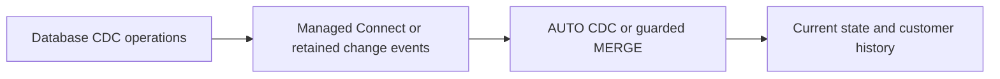
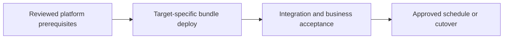

# CDC with hard deletes and customer history

Choose current state versus type-2 history and explicitly handle out-of-order changes.

## Data design

## Exact input/field checklist

| Input or setting | Fill with |
|---|---|
| `keys` | Customer business key |
| `sequence_by` | Source monotonic sequence or documented composite |
| `apply_as_deletes` | op = 'D' |
| `stored_as_scd_type` | 2 for history |
| `track_history_column_list` | Approved attributes only |

## Walkthrough and buttons

1. Require a complete source change contract including inserts, updates, deletes, ordering, null-patch interpretation, and retention.
2. Configure managed ingestion through chapter 11 or ingest raw operations through files/Kafka. Avoid a timestamp-only pull for hard deletes.
3. In chapter 14 pipeline settings add Configuration for Python structural values. Add chapter 15 AUTO CDC with target streaming table, key, sequence, delete predicate, and type 2.
4. Choose which columns create history, and use validity intervals consistently. Do not let processing metadata create unwanted business versions.
5. Size tombstone/source retention beyond observed late arrival and recovery lag; test duplicate/conflicting sequence records before allowing them into CDC.
6. Expose a governed current view and a separate historical query contract; document how deletes close history and whether snapshots erase it.

The linked recipes contain the exact button sequences, code, and prerequisites: [11. Lakeflow Connect: managed SQL Server CDC](../chapters/11-managed-cdc.md); [14. Lakeflow declarative pipelines: Python, SQL, and configuration](../chapters/14-declarative-pipelines.md); [15. Ordered CDC, MERGE, hard deletes, and SCD history](../chapters/15-cdc-scd-merge.md); [18. Secrets, service principals, Run as, and authentication](../chapters/18-secrets-and-service-principals.md); [25. Tests: local, Spark, workspace, contracts, and production gates](../chapters/25-test-strategy.md); [31. Delta change data feed and version-bound recovery](../chapters/31-change-data-feed.md).

## Governance and infrastructure automation

History and deleted values can remain sensitive. Govern raw/current/history independently; approve policy and retention. Pipeline Run as owns published assets.

## Code push automation and maintenance

Deploy pipeline resources through bundles, with Terraform owning source connection/bootstrap if chosen. Avoid two engines writing the same history target.

## Tests to automate and tests to rehearse

Automate late updates/deletes, repeated changes, null patches, identical/conflicting ordering ties, nonoverlapping intervals, and exactly one active version.

## Technology substitutions

Use the same business contract and acceptance fixture when replacing one component. Files can use COPY INTO for smaller bounded deliveries or Auto Loader for incremental scale; custom Jobs transforms can be replaced by Lakeflow declarative tables if their state/ownership semantics fit. Custom extraction can be replaced by managed Connect only for supported connectors/contracts. Azure/AWS/GCP and CI-vendor replacements require the identity/network/feature changes in chapters 22 and 30; they are not a promise that every Cartesian combination is valid.

## Completion evidence

Save source boundary, reviewed code SHA, resolved parameters, run URL, table versions, reconciliation/access results, and measured freshness/recovery/cost. This recipe is a design/lab guide; it was not executed in a customer workspace.

[Guide index](../../DATABRICKS_GUIDE_INDEX.md)
