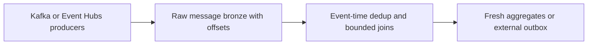
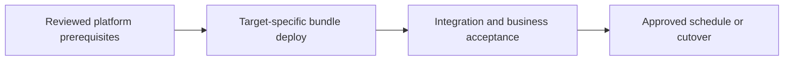

# Kafka/Event Hubs events and near-real-time aggregates

Build streaming analytics with bounded state, raw replay, and a stated freshness target.

## Data design

## Exact input/field checklist

| Input or setting | Fill with |
|---|---|
| `bootstrap_servers` | Actual host and Kafka port |
| `subscribe` | orders topic/Event Hub entity |
| `service_credential` | Source-scoped credential |
| `checkpoint_path` | Stable query-specific path |
| `lateness` | Measured policy, example 2 hours |

## Walkthrough and buttons

1. Decide ingestion-to-table freshness versus end-user request latency; a lakehouse analytics stream is not automatically a submillisecond online decision service.
2. Configure chapter 13 authentication, ACLs, and connectivity. Preserve offsets, payload, producer event ID, and event time in bronze.
3. Pick bounded AvailableNow jobs for periodic freshness or supported persistent streaming execution for proven low-latency needs; benchmark the whole path.
4. Use chapter 16 watermarks, deduplication, and time-bounded joins. Keep raw replay for corrections beyond state retention.
5. Use a Delta result for analytics; for external APIs/databases add transactional/idempotent delivery or outbox rather than plain retrying append.
6. Monitor source lag, event-time freshness, state size, and batch duration; alert before source retention expires.

The linked recipes contain the exact button sequences, code, and prerequisites: [13. Kafka and Event Hubs: offsets, authentication, and sinks](../chapters/13-kafka-event-hubs.md); [14. Lakeflow declarative pipelines: Python, SQL, and configuration](../chapters/14-declarative-pipelines.md); [16. Watermarks, state, streaming joins, and external sink delivery](../chapters/16-stream-state-and-external-sinks.md); [18. Secrets, service principals, Run as, and authentication](../chapters/18-secrets-and-service-principals.md); [26. Monitoring, audit, freshness, and cost](../chapters/26-observability-cost.md).

## Governance and infrastructure automation

Source service credentials, UC bronze policies, external sink identity, and execution-plane networking are separate. Protect payloads/credentials and retained replay.

## Code push automation and maintenance

Jobs, Lakeflow pipelines, and external orchestration are alternative owners. CI tests/deploys reviewed code; source production remains independently scheduled.

## Tests to automate and tests to rehearse

Automate duplicate event IDs, poison payloads, hot keys, late events, idle join input, source log loss, and crash after external sink commit.

## Technology substitutions

Use the same business contract and acceptance fixture when replacing one component. Files can use COPY INTO for smaller bounded deliveries or Auto Loader for incremental scale; custom Jobs transforms can be replaced by Lakeflow declarative tables if their state/ownership semantics fit. Custom extraction can be replaced by managed Connect only for supported connectors/contracts. Azure/AWS/GCP and CI-vendor replacements require the identity/network/feature changes in chapters 22 and 30; they are not a promise that every Cartesian combination is valid.

## Completion evidence

Save source boundary, reviewed code SHA, resolved parameters, run URL, table versions, reconciliation/access results, and measured freshness/recovery/cost. This recipe is a design/lab guide; it was not executed in a customer workspace.

[Guide index](../../DATABRICKS_GUIDE_INDEX.md)
