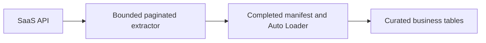
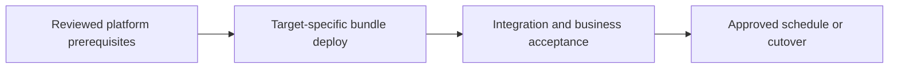

# SaaS REST ingestion with pagination and rate limits

Ingest a vendor API while preserving raw response evidence and completion boundaries.

## Data design

## Exact input/field checklist

| Input or setting | Fill with |
|---|---|
| `endpoint` | Allowlisted vendor URL |
| `page_size` | Vendor-supported, example 500 |
| `timeout_seconds` | 30 example |
| `max_pages` | 100 example |
| `secret_scope_key` | Approved scope/token key |

## Walkthrough and buttons

1. Prefer a supported managed connector when its objects/incremental/delete semantics match. Otherwise adapt the chapter 12 custom extractor to the documented vendor contract.
2. Create source credentials and network/allowlists. Add non-sensitive notebook widgets and a job task preceding ingestion.
3. Extract to a new staging run directory. Write immutable pages, detect cursor loops, and write the completion manifest last.
4. Expose only completed data to ingestion; move completed page files to the watched prefix or drive an explicit manifest-aware ingestion controller. Never load manifest JSON as an order.
5. Advance the source cursor only after durable completion; use stable identifiers to deduplicate re-extracted business rows.
6. For deletes require a vendor deletion endpoint/event, tombstone, or verified complete scoped snapshot comparison; absence from one page is not deletion.

The linked recipes contain the exact button sequences, code, and prerequisites: [07. Lakeflow Jobs, dependencies, task values, and loops](../chapters/07-jobs-task-values.md); [09. Auto Loader: schema, checkpoints, triggers, and replay](../chapters/09-auto-loader.md); [12. APIs and SaaS: pagination, limits, and durable landing](../chapters/12-apis-saas.md); [18. Secrets, service principals, Run as, and authentication](../chapters/18-secrets-and-service-principals.md); [25. Tests: local, Spark, workspace, contracts, and production gates](../chapters/25-test-strategy.md).

## Governance and infrastructure automation

Restrict raw API data and token access. Provision egress and source rate-budget ownership; use a sandbox identity for tests.

## Code push automation and maintenance

CI vendor choice does not change pagination semantics. Keep vendor adapters versioned, contract fixtures recorded, and deployments separate from cursor advancement.

## Tests to automate and tests to rehearse

Automate 429/5xx/401, empty continuation page, expired cursor, loop, partial write, max-page exhaustion, and rerun before/after manifest.

## Technology substitutions

Use the same business contract and acceptance fixture when replacing one component. Files can use COPY INTO for smaller bounded deliveries or Auto Loader for incremental scale; custom Jobs transforms can be replaced by Lakeflow declarative tables if their state/ownership semantics fit. Custom extraction can be replaced by managed Connect only for supported connectors/contracts. Azure/AWS/GCP and CI-vendor replacements require the identity/network/feature changes in chapters 22 and 30; they are not a promise that every Cartesian combination is valid.

## Completion evidence

Save source boundary, reviewed code SHA, resolved parameters, run URL, table versions, reconciliation/access results, and measured freshness/recovery/cost. This recipe is a design/lab guide; it was not executed in a customer workspace.

[Guide index](../../DATABRICKS_GUIDE_INDEX.md)
