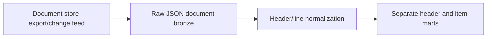
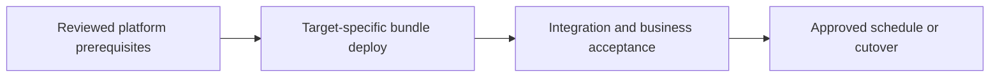

# Document/NoSQL source to header and line facts

Flatten nested records without losing deletes, schema changes, or business grain.

## Data design

## Exact input/field checklist

| Input or setting | Fill with |
|---|---|
| `source_id` | Document ID plus source partition |
| `source_version` | Version/order from source contract |
| `schema_policy` | Explicit nested schema or supported VARIANT |
| `line_key` | Stable source line ID preferred |
| `delete_mode` | Documented source feed mode |

## Walkthrough and buttons

1. Confirm whether your document-store source mode emits full records, patches, and deletes, and its retention. Select a supported connector or controlled JSON export.
2. Use chapter 32 raw metadata and separate state/schema paths; do not reuse the flat orders schema.
3. Cast business types and quarantine invalid/unknown records; keep raw evidence for schema evolution.
4. Create header facts at one row/order and line facts at one row/stable item key; decide null/empty-array behavior.
5. Use ordered state application for updates/deletes, and test patches independently of full-record replacement.
6. Publish header revenue separately from line joins or define a reconciled allocation; verify reorder does not create duplicate lines.

The linked recipes contain the exact button sequences, code, and prerequisites: [09. Auto Loader: schema, checkpoints, triggers, and replay](../chapters/09-auto-loader.md); [15. Ordered CDC, MERGE, hard deletes, and SCD history](../chapters/15-cdc-scd-merge.md); [17. Gold tables, SQL warehouses, dbt, and exports](../chapters/17-gold-and-sql-serving.md); [19. Governance: row filters, masking, lineage, tags, and ABAC](../chapters/19-fine-grained-governance.md); [32. NoSQL, nested JSON, schema drift, and grain changes](../chapters/32-nosql-json.md).

## Governance and infrastructure automation

NoSQL documents often carry mixed sensitive fields. Restrict raw data, apply curated policies, and review external export identity/source partition limits.

## Code push automation and maintenance

Pin connector/package and schema contract per runtime. Deploy reviewed transforms in bundles; test old/new nested fixtures before promotion.

## Tests to automate and tests to rehearse

Automate null/empty arrays, item reorder, missing fields, schema drift, partial patches, late deletes, and header-to-lines multiplication.

## Technology substitutions

Use the same business contract and acceptance fixture when replacing one component. Files can use COPY INTO for smaller bounded deliveries or Auto Loader for incremental scale; custom Jobs transforms can be replaced by Lakeflow declarative tables if their state/ownership semantics fit. Custom extraction can be replaced by managed Connect only for supported connectors/contracts. Azure/AWS/GCP and CI-vendor replacements require the identity/network/feature changes in chapters 22 and 30; they are not a promise that every Cartesian combination is valid.

## Completion evidence

Save source boundary, reviewed code SHA, resolved parameters, run URL, table versions, reconciliation/access results, and measured freshness/recovery/cost. This recipe is a design/lab guide; it was not executed in a customer workspace.

[Guide index](../../DATABRICKS_GUIDE_INDEX.md)
