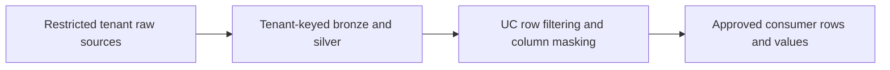
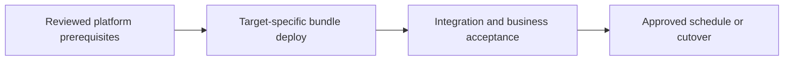

# Multi-tenant PII platform with row and column controls

Let teams query shared curated tables under explicit policy and workspace isolation.

## Data design

## Exact input/field checklist

| Input or setting | Fill with |
|---|---|
| `tenant_key` | Required source/curated tenant ID |
| `reader_groups` | Account-level groups |
| `row_function` | Typed SQL UDF or ABAC row policy |
| `mask_function` | Typed SQL UDF or ABAC mask policy |
| `workspace_binding` | Dev/prod/catalog isolation |

## Walkthrough and buttons

1. Define whether tenancy isolation is by catalog/schema or policy on a shared table; choose based on ownership and risk, not just convenience.
2. Bootstrap account groups/workspace assignments/catalog bindings through chapters 04 and 18.
3. Use chapter 19 Catalog table Overview → Add filter / Mask with explicit function argument bindings; create the UDF first.
4. Introduce governed tags and ABAC only after checking supported policy/runtime/compute requirements; tags alone enforce nothing.
5. Test real consumer identities through their SQL warehouse/dashboard execution mode, not only the policy owner.
6. Review exported files/shares and direct cloud IAM, because bypassing UC can defeat the intended policy.

The linked recipes contain the exact button sequences, code, and prerequisites: [04. Catalogs, schemas, volumes, and minimum grants](../chapters/04-catalogs-volumes-grants.md); [18. Secrets, service principals, Run as, and authentication](../chapters/18-secrets-and-service-principals.md); [19. Governance: row filters, masking, lineage, tags, and ABAC](../chapters/19-fine-grained-governance.md); [23. Terraform, policies, cloud networking, and resource ownership](../chapters/23-terraform-and-network.md); [25. Tests: local, Spark, workspace, contracts, and production gates](../chapters/25-test-strategy.md); [33. Federation connections, foreign catalogs, and governed sharing](../chapters/33-federation-sharing.md).

## Governance and infrastructure automation

Separate stewards, policy administrators, pipeline writers, and consumers. Govern grants/policies/functions/tags as platform artifacts with audit evidence.

## Code push automation and maintenance

Promote policies and code through coordinated migrations. Test table replacement/schema change policy persistence; avoid broad admin identity for applications.

## Tests to automate and tests to rehearse

Automate cross-tenant denial, masked/unmasked groups, null/wrong types, group changes, policy conflict, external export, and query performance.

## Technology substitutions

Use the same business contract and acceptance fixture when replacing one component. Files can use COPY INTO for smaller bounded deliveries or Auto Loader for incremental scale; custom Jobs transforms can be replaced by Lakeflow declarative tables if their state/ownership semantics fit. Custom extraction can be replaced by managed Connect only for supported connectors/contracts. Azure/AWS/GCP and CI-vendor replacements require the identity/network/feature changes in chapters 22 and 30; they are not a promise that every Cartesian combination is valid.

## Completion evidence

Save source boundary, reviewed code SHA, resolved parameters, run URL, table versions, reconciliation/access results, and measured freshness/recovery/cost. This recipe is a design/lab guide; it was not executed in a customer workspace.

[Guide index](../../DATABRICKS_GUIDE_INDEX.md)
