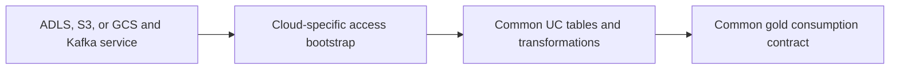
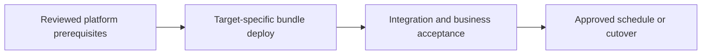

# Same file/Kafka lakehouse across Azure, AWS, and GCP

Reuse the logical design while replacing cloud-specific identity, network, and service settings.

## Data design

## Exact input/field checklist

| Input or setting | Fill with |
|---|---|
| `cloud_uri` | abfss://, s3://, or gs:// under approved locations |
| `credential` | Cloud-specific UC storage/service object |
| `workspace_host` | Correct cloud/account endpoint |
| `node_type_id` | Allowed cloud/region-specific value |
| `target` | Separate bundle target per environment |

## Walkthrough and buttons

1. Use chapter 30 matrix to distinguish logical equivalents from protocol differences. Pub/Sub is not a Kafka hostname replacement.
2. Bootstrap storage credentials/external locations using the cloud-specific official procedure; Azure HNS requirements and GCP HNS limitations differ.
3. Expose source files as UC volumes and retain common /Volumes-based application paths where suitable.
4. Change bundle host, catalog, compute/policy, credential names, and networking through target variables; do not modify transformation semantics casually.
5. Run the same golden business fixtures and access tests on each chosen deployment. Measure source/load/egress and runtime-feature differences.
6. If centralizing cross-cloud data, design duplication/transfer/consistency explicitly; a catalog definition does not transfer bytes for free.

The linked recipes contain the exact button sequences, code, and prerequisites: [03. Azure storage identity and external locations](../chapters/03-azure-storage-identity.md); [04. Catalogs, schemas, volumes, and minimum grants](../chapters/04-catalogs-volumes-grants.md); [13. Kafka and Event Hubs: offsets, authentication, and sinks](../chapters/13-kafka-event-hubs.md); [20. Bundles: variables, targets, resources, and deployment commands](../chapters/20-bundles.md); [23. Terraform, policies, cloud networking, and resource ownership](../chapters/23-terraform-and-network.md); [30. Cloud substitutions, federation, sharing, and recovery](../chapters/30-clouds-and-recovery.md).

## Governance and infrastructure automation

Cloud IAM/trust/private routing and UC policies must be reconciled separately in each cloud. Bind production objects to intended workspaces.

## Code push automation and maintenance

Any chosen CI vendor can invoke bundles, with the appropriate auth adapter. Separate Terraform backend/provider resources and app target deployment state.

## Tests to automate and tests to rehearse

Automate semantic output parity, feature availability checks, allowed/denied reads, protocol/auth failures, and measured latency/egress budget.

## Technology substitutions

Use the same business contract and acceptance fixture when replacing one component. Files can use COPY INTO for smaller bounded deliveries or Auto Loader for incremental scale; custom Jobs transforms can be replaced by Lakeflow declarative tables if their state/ownership semantics fit. Custom extraction can be replaced by managed Connect only for supported connectors/contracts. Azure/AWS/GCP and CI-vendor replacements require the identity/network/feature changes in chapters 22 and 30; they are not a promise that every Cartesian combination is valid.

## Completion evidence

Save source boundary, reviewed code SHA, resolved parameters, run URL, table versions, reconciliation/access results, and measured freshness/recovery/cost. This recipe is a design/lab guide; it was not executed in a customer workspace.

[Guide index](../../DATABRICKS_GUIDE_INDEX.md)
