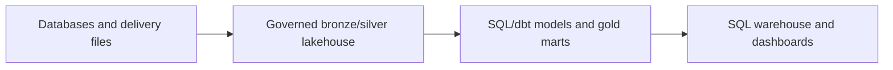
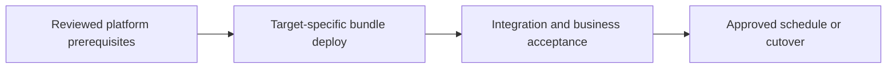

# Warehouse modernization: SQL/dbt marts and concurrent BI

Serve governed metrics while migrating legacy SQL and controlling query performance.

## Data design

## Exact input/field checklist

| Input or setting | Fill with |
|---|---|
| `warehouse` | Approved SQL warehouse ID/type |
| `metric_grain` | Order/date/region contract |
| `sql_parameters` | start_date/end_date/region |
| `model_contract` | Types, keys, history, decimal precision |
| `refresh` | Freshness target and scheduler |

## Walkthrough and buttons

1. Inventory legacy views/reports and define business metric/date/grain contracts. Translate SQL deliberately: timezone, null, ANSI, and interval behavior can differ.
2. Choose chapter 10/11 extraction or chapter 33 federation for initial exploration; production serving should meet the source-load and availability contract.
3. Use chapter 17 gold SQL or dbt models. Configure warehouse fields through its UI or Terraform and pass runtime SQL values using named markers.
4. Test legacy and new reports against the same source boundary; resolve semantic differences before switching dashboards.
5. Benchmark representative concurrent consumers and apply chapter 27 measured tuning; small fixture latency is not a concurrency benchmark.
6. Publish only reconciled gold and a freshness marker; track query failures, cost, and user access after cutover.

The linked recipes contain the exact button sequences, code, and prerequisites: [10. Database snapshots, JDBC, and incremental extraction](../chapters/10-jdbc-and-incremental.md); [11. Lakeflow Connect: managed SQL Server CDC](../chapters/11-managed-cdc.md); [17. Gold tables, SQL warehouses, dbt, and exports](../chapters/17-gold-and-sql-serving.md); [25. Tests: local, Spark, workspace, contracts, and production gates](../chapters/25-test-strategy.md); [26. Monitoring, audit, freshness, and cost](../chapters/26-observability-cost.md); [27. Performance, liquid clustering, file sizes, and table maintenance](../chapters/27-performance-delta.md); [33. Federation connections, foreign catalogs, and governed sharing](../chapters/33-federation-sharing.md).

## Governance and infrastructure automation

Consumers need warehouse CAN_USE and approved UC SELECT. Test credential/execution mode of actual dashboards and restrict source/PII marts.

## Code push automation and maintenance

Version dbt/SQL models and tests, warehouses in platform IaC, jobs in bundles. Coordinate BI artifact/schema releases with the same reviewed commit.

## Tests to automate and tests to rehearse

Automate join multiplicity, current/history semantics, revenue parity, denied access, freshness, and concurrent p95 query latency.

## Technology substitutions

Use the same business contract and acceptance fixture when replacing one component. Files can use COPY INTO for smaller bounded deliveries or Auto Loader for incremental scale; custom Jobs transforms can be replaced by Lakeflow declarative tables if their state/ownership semantics fit. Custom extraction can be replaced by managed Connect only for supported connectors/contracts. Azure/AWS/GCP and CI-vendor replacements require the identity/network/feature changes in chapters 22 and 30; they are not a promise that every Cartesian combination is valid.

## Completion evidence

Save source boundary, reviewed code SHA, resolved parameters, run URL, table versions, reconciliation/access results, and measured freshness/recovery/cost. This recipe is a design/lab guide; it was not executed in a customer workspace.

[Guide index](../../DATABRICKS_GUIDE_INDEX.md)
