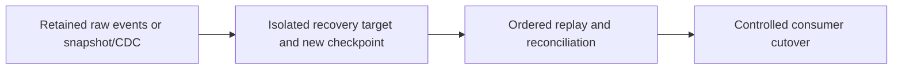

# Backfill, lost checkpoints, and region recovery

Recover data state without silently skipping retained changes or duplicating external effects.

## Data design

## Exact input/field checklist

| Input or setting | Fill with |
|---|---|
| `source_boundary` | Known committed version/offset/snapshot |
| `recovery_checkpoint` | New path for new replay lineage |
| `target_catalog` | Isolated recovery namespace |
| `retention` | Above worst recovery/consumer lag |
| `RPO_RTO` | Measured targets |

## Walkthrough and buttons

1. Classify lost code, metadata/grants, table files/logs, source history, or checkpoint. Each requires a different recovery asset.
2. Stop competing writers safely, capture existing table/source boundaries, and preserve failed state for diagnosis.
3. Create an isolated target with recreated permissions and a new checkpoint. Use chapter 31 startingVersion only if retained and the target boundary is known.
4. Replay including updates/deletes, reconcile keys/totals/history/policies, and verify external effects are idempotent.
5. Switch consumers only after acceptance. Keep old target available for the agreed recovery period.
6. Measure RPO/RTO and update retention/network/identity backups accordingly; code rollback does not recover vacuumed data.

The linked recipes contain the exact button sequences, code, and prerequisites: [15. Ordered CDC, MERGE, hard deletes, and SCD history](../chapters/15-cdc-scd-merge.md); [16. Watermarks, state, streaming joins, and external sink delivery](../chapters/16-stream-state-and-external-sinks.md); [23. Terraform, policies, cloud networking, and resource ownership](../chapters/23-terraform-and-network.md); [27. Performance, liquid clustering, file sizes, and table maintenance](../chapters/27-performance-delta.md); [30. Cloud substitutions, federation, sharing, and recovery](../chapters/30-clouds-and-recovery.md); [31. Delta change data feed and version-bound recovery](../chapters/31-change-data-feed.md).

## Governance and infrastructure automation

Restore identity, UC metadata/policies, secrets, storage data, and network dependencies. A cloud copy alone is not a complete governed workspace recovery.

## Code push automation and maintenance

Infrastructure restore and application redeploy are separate stages. Use reviewed replay tooling; never generic delete-checkpoint or bundle-destroy as rollback.

## Tests to automate and tests to rehearse

Automate replay correctness within retention, fail for expired source boundary, access-policy parity, cutover checks, and external post-commit retry.

## Technology substitutions

Use the same business contract and acceptance fixture when replacing one component. Files can use COPY INTO for smaller bounded deliveries or Auto Loader for incremental scale; custom Jobs transforms can be replaced by Lakeflow declarative tables if their state/ownership semantics fit. Custom extraction can be replaced by managed Connect only for supported connectors/contracts. Azure/AWS/GCP and CI-vendor replacements require the identity/network/feature changes in chapters 22 and 30; they are not a promise that every Cartesian combination is valid.

## Completion evidence

Save source boundary, reviewed code SHA, resolved parameters, run URL, table versions, reconciliation/access results, and measured freshness/recovery/cost. This recipe is a design/lab guide; it was not executed in a customer workspace.

[Guide index](../../DATABRICKS_GUIDE_INDEX.md)
