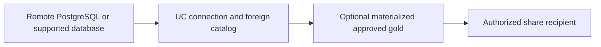
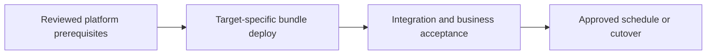

# Federated migration discovery and partner data sharing

Read external data with foreign catalogs, then disclose only approved assets to recipients.

## Data design

## Exact input/field checklist

| Input or setting | Fill with |
|---|---|
| `connection_type` | PostgreSQL example |
| `host_port` | Source host and 5432 |
| `foreign_database` | sales example |
| `share` | de_lab_gold_share |
| `recipient` | Explicit approved recipient mode |

## Walkthrough and buttons

1. Use chapter 33 connection wizard and foreign catalog fields. Confirm source permissions/TLS/network and qualifying compute.
2. Query representative remote data and inspect pushdown/source load; choose ingestion when source SLA/history requirements require materialization.
3. Build and reconcile approved gold; do not share exploratory raw PII simply because it is accessible.
4. Set up provider/share/recipient with the current sharing documentation and account privileges.
5. Verify the recipient client/mode can access the intended table/view and honors supported policy/history behavior.
6. Record disclosure/retention/revocation ownership and test recipient revocation. Sharing is not writable cross-region failover.

The linked recipes contain the exact button sequences, code, and prerequisites: [04. Catalogs, schemas, volumes, and minimum grants](../chapters/04-catalogs-volumes-grants.md); [17. Gold tables, SQL warehouses, dbt, and exports](../chapters/17-gold-and-sql-serving.md); [19. Governance: row filters, masking, lineage, tags, and ABAC](../chapters/19-fine-grained-governance.md); [30. Cloud substitutions, federation, sharing, and recovery](../chapters/30-clouds-and-recovery.md); [33. Federation connections, foreign catalogs, and governed sharing](../chapters/33-federation-sharing.md).

## Governance and infrastructure automation

Connections and shares are UC securables, with distinct source-system rights and recipient authorization. Approve data disclosure explicitly.

## Code push automation and maintenance

Terraform/platform metadata owns connections/shares when selected; bundles own materialization code. Deploy consumer contract changes as reviewed releases.

## Tests to automate and tests to rehearse

Automate source unavailable/denied, type mapping/pushdown, share allow/deny/revoke, schema change, and consumer-client compatibility.

## Technology substitutions

Use the same business contract and acceptance fixture when replacing one component. Files can use COPY INTO for smaller bounded deliveries or Auto Loader for incremental scale; custom Jobs transforms can be replaced by Lakeflow declarative tables if their state/ownership semantics fit. Custom extraction can be replaced by managed Connect only for supported connectors/contracts. Azure/AWS/GCP and CI-vendor replacements require the identity/network/feature changes in chapters 22 and 30; they are not a promise that every Cartesian combination is valid.

## Completion evidence

Save source boundary, reviewed code SHA, resolved parameters, run URL, table versions, reconciliation/access results, and measured freshness/recovery/cost. This recipe is a design/lab guide; it was not executed in a customer workspace.

[Guide index](../../DATABRICKS_GUIDE_INDEX.md)
