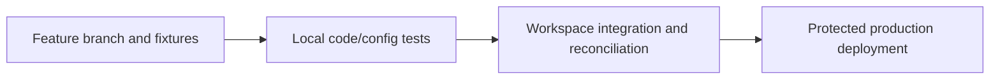
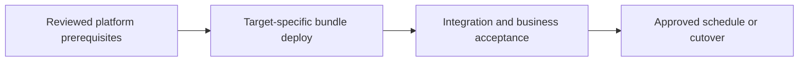

# Dev/test/prod CI/CD, schema evolution, and runtime upgrades

Promote a tested application and distinguish code, schema, policy, and state changes.

## Data design

## Exact input/field checklist

| Input or setting | Fill with |
|---|---|
| `bundle_target` | dev/test/prod defined in your project |
| `BUNDLE_VAR_workspace_host` | Target-specific actual host |
| `run_as_sp` | Execution application ID |
| `CI_auth` | Vendor-specific federation or OAuth M2M |
| `release` | Same reviewed source SHA |

## Walkthrough and buttons

1. Use chapter 24 Git folder or local Git workflow; review diffs and maintain thin entry notebooks plus reusable modules.
2. Run chapter 25 local and static checks; no production credentials on PR jobs.
3. Configure chapter 21 protected environment/federation or chapter 22 equivalent vendor setup. Deploy to test workspace and execute fixture job twice.
4. For schema/runtime/policy/state changes add migration and compatibility tests; a schema check alone cannot prove runtime execution.
5. Promote the exact tested commit with prod target/host/run-as and serialized deployment state. Confirm updated resource IDs and resolved defaults.
6. Rollback code via reviewed previous revision; handle irreversible data/protocol/policy migrations separately with the rehearsed recovery plan.

The linked recipes contain the exact button sequences, code, and prerequisites: [18. Secrets, service principals, Run as, and authentication](../chapters/18-secrets-and-service-principals.md); [20. Bundles: variables, targets, resources, and deployment commands](../chapters/20-bundles.md); [21. GitHub Actions deployment with workload identity federation](../chapters/21-github-actions.md); [22. Azure DevOps, Jenkins, GitLab, and orchestration alternatives](../chapters/22-other-ci-systems.md); [23. Terraform, policies, cloud networking, and resource ownership](../chapters/23-terraform-and-network.md); [24. Git folders, code structure, packages, and runtime upgrades](../chapters/24-git-and-maintenance.md); [25. Tests: local, Spark, workspace, contracts, and production gates](../chapters/25-test-strategy.md); [34. Troubleshooting by symptom, field, and evidence](../chapters/34-troubleshooting.md).

## Governance and infrastructure automation

Separate deploy and run identities, bootstrap privileged platform objects outside application deployment, and protect deployment environments/variables.

## Code push automation and maintenance

GitHub Actions, Azure DevOps, Jenkins, GitLab can share bundle commands. Choose one deployment owner and one scheduler; pin tool/dependency versions.

## Tests to automate and tests to rehearse

Automate invalid parameter/reference/path, wrong identity/subject, failed fixture gate, output parity after runtime upgrade, and deployment serialization.

## Technology substitutions

Use the same business contract and acceptance fixture when replacing one component. Files can use COPY INTO for smaller bounded deliveries or Auto Loader for incremental scale; custom Jobs transforms can be replaced by Lakeflow declarative tables if their state/ownership semantics fit. Custom extraction can be replaced by managed Connect only for supported connectors/contracts. Azure/AWS/GCP and CI-vendor replacements require the identity/network/feature changes in chapters 22 and 30; they are not a promise that every Cartesian combination is valid.

## Completion evidence

Save source boundary, reviewed code SHA, resolved parameters, run URL, table versions, reconciliation/access results, and measured freshness/recovery/cost. This recipe is a design/lab guide; it was not executed in a customer workspace.

[Guide index](../../DATABRICKS_GUIDE_INDEX.md)
